# PL-300 Lab 03: Configuración de un Modelo Semántico en Power BI

Este repositorio contiene la guía de laboratorio, arquitectura de datos y plantilla de evidencias para el  **Lab 03: Configure a Semantic Model in Power BI**  del curso  **PL-300: Microsoft Power BI Data Analyst** .

--------------------------------------------------------------------------------

### 📑 Tabla de Contenidos
*  [🎯 Objetivo y Lógica de Negocio](#-objetivo-y-lógica-de-negocio)
    *  [Bloque 1: Arquitectura de Relaciones y Esquema en Estrella](#bloque-1-arquitectura-de-relaciones-y-esquema-en-estrella)
    *  [Bloque 2: Ergonomía del Modelo y Navegación Jerárquica](#bloque-2-ergonomía-del-modelo-y-navegación-jerárquica)
    *  [Bloque 3: Optimización de Tipos, Formatos y Ocultación Técnica](#bloque-3-optimización-de-tipos-formatos-y-ocultación-técnica)
    *  [Bloque 4: Capa de Métricas de Rentabilidad (Medidas Rápidas)](#bloque-4-capa-de-métricas-de-rentabilidad-medidas-rápidas)
    *  [Bloque 5: Resolución de Relaciones Muchos a Muchos y Rendimiento](#bloque-5-resolución-de-relaciones-muchos-a-muchos-y-rendimiento)
*  [🛠️ Tecnologías y Entorno](#️-tecnologías-y-entorno)
* [🛠️ Realización del Laboratorio](#️-realización-del-laboratorio)
    *  [Historia del laboratorio](#historia-del-laboratorio)
    *  [Inicio](#inicio)
    *  [Bloque 1: Arquitectura de Relaciones y Esquema en Estrella](#bloque-1-arquitectura-de-relaciones-y-esquema-en-estrella)
        *  [Crear relaciones con modelos](#crear-relaciones-con-modelos)
        *  [Crea relaciones adicionales](#crea-relaciones-adicionales)
    *  [Bloque 2: Ergonomía del Modelo y Navegación Jerárquica](#bloque-2-ergonomía-del-modelo-y-navegación-jerárquica)
        *  [Configurar la tabla de productos](#configurar-la-tabla-de-productos)
        *  [Configurar la tabla de Regiones](#configurar-la-tabla-de-regiones)
        *  [Configurar la tabla de revendedores](#configurar-la-tabla-de-revendedores)
    *  [Bloque 3: Optimización de Tipos, Formatos y Ocultación Técnica](#bloque-3-optimización-de-tipos-formatos-y-ocultación-técnica)
        *  [Configurar la tabla de ventas](#configurar-la-tabla-de-ventas)
        *  [Propiedades de actualización masiva](#propiedades-de-actualización-masiva)
        *  [Explora la interfaz del modelo](#explora-la-interfaz-del-modelo)
    *  [Bloque 4: Capa de Métricas de Rentabilidad (Medidas Rápidas)](#bloque-4-capa-de-métricas-de-rentabilidad-medidas-rápidas)
        *  [Crea medidas rápidas](#crea-medidas-rápidas)
    *  [Bloque 5: Resolución de Relaciones Muchos a Muchos y Rendimiento](#bloque-5-resolución-de-relaciones-muchos-a-muchos-y-rendimiento)
        *  [Crea una relación de muchos a muchos](#crea-una-relación-de-muchos-a-muchos)
            *  [Paso 1: Crear el visual de rendimiento base](#paso-1-crear-el-visual-de-rendimiento-base)
            *  [Paso 2: Conectar la tabla puente](#paso-2-conectar-la-tabla-puente)
            *  [Paso 3: Configurar el filtro cruzado bidireccional](#paso-3-configurar-el-filtro-cruzado-bidireccional)
            *  [Paso 4: Desactivar la relación directa y renombrar](#paso-4-desactivar-la-relación-directa-y-renombrar)
        *  [Relacionar la tabla de Objetivos](#relacionar-la-tabla-de-objetivos)
            *  [Paso 5: Vincular la tabla de objetivos Targets](#paso-5-vincular-la-tabla-de-objetivos-targets)
        *  [Laboratorio completo](#laboratorio-completo)
*  [🧠 Decisiones Técnicas Destacadas (Key Takeaways)](#-decisiones-técnicas-destacadas-key-takeaways)
*  [✅ Lista de Verificación (Checklist)](#-lista-de-verificación-checklist)
*  [🧭 Navegación entre Laboratorios](#-navegación-entre-laboratorios)

--------------------------------------------------------------------------------

## 🎯 Objetivo y Lógica de Negocio
El propósito de este laboratorio consiste en transformar las consultas aisladas e importadas durante la fase ETL en un  **modelo semántico dimensional (esquema en estrella)**  optimizado para el autoservicio de análisis ( *Self-Service BI* ). Se definen caminos claros de propagación de filtros, se estructuran jerarquías de agregación y se resuelve la ambigüedad en relaciones complejas para garantizar la integridad métrica.
### Bloque 1: Arquitectura de Relaciones y Esquema en Estrella
*   **Objetivo:**  Garantizar la propagación unívoca del contexto de filtro desde las entidades maestras hacia la tabla de transacciones de ventas.
*   **Lógica de negocio:**  Conexión de la tabla transaccional Sales con sus dimensiones satélite (Product, Reseller, Region, Salesperson) mediante relaciones de cardinalidad uno a varios ($1:*$) y dirección de filtro cruzado única ( *Single* ). Esto garantiza que los filtros fluyan desde el extremo dimensional hacia el granular sin introducir ciclos cerrados ni duplicidades.
### Bloque 2: Ergonomía del Modelo y Navegación Jerárquica
*   **Objetivo:**  Habilitar experiencias de exploración multinivel ( *drill-down* ) y simplificar el catálogo de datos.
*   **Lógica de negocio:**
    *   **Jerarquías analíticas:**  Modelado de jerarquías en Product (Products: Category $\rightarrow$ Subcategory $\rightarrow$ Product) y territorios en Region y Reseller (Regions y Geography), optimizando el análisis desde la dirección corporativa hasta la tienda o código local.
    *   ***Carpetas de visualización (Display Folders):***  Aislamiento de atributos auxiliares (como Background Color Format y Font Color Format dentro de la carpeta Formatting) para evitar ruido analítico al crear informes.
    *   **Categorización geográfica:**  Declaración explícita de metadatos espaciales (Country/Region, State or Province, City) para habilitar el motor de geolocalización en mapas interactivos de Power BI.
### Bloque 3: Optimización de Tipos, Formatos y Ocultación Técnica
*   **Objetivo:**  Prevenir agregaciones incorrectas de negocio y ocultar claves del pipeline relacional.
*   **Lógica de negocio:**
    *   **Ocultación en masa:**  Ocultar 13 claves técnicas foráneas y subrogadas (ProductKey, EmployeeKey, etc.) para impedir que se utilicen como métricas sumables en los visuales.
    *   **Agregaciones por defecto:**  Configuración de Unit Price en modo promedio ( *Average* ) para evitar la suma inconsistente de tipos unitarios, así como la normalización de posiciones decimales a cero en costes y ventas consolidadas.
    *   **Supresión de Time Intelligence automático:**  Desactivación global de la opción de fecha/hora automática en el archivo, evitando tablas ocultas que asumen año natural frente al calendario fiscal corporativo (inicio en julio) de Adventure Works.
### Bloque 4: Capa de Métricas de Rentabilidad (Medidas Rápidas)
*   **Objetivo:**  Modelar indicadores financieros dinámicos evaluados bajo cualquier contexto de filtro.
*   **Lógica de negocio:**  Creación de las métricas clave de margen bruto:
    *  $\text{Profit} = \text{Sales} - \text{Cost}$
    *  $\text{Profit Margin} = \frac{\text{Profit}}{\text{Sales}}$ (formateada como porcentaje con dos decimales)
### Bloque 5: Resolución de Relaciones Muchos a Muchos y Rendimiento
*   **Objetivo:**  Resolver el desacoplamiento entre las ventas directas y el rendimiento global por áreas comerciales.
*   **Lógica de negocio:**
    *  Un comercial puede tener asignados múltiples territorios y un territorio contar con varios representantes. Se implementa una relación  *many-to-many*  utilizando SalespersonRegion como tabla puente ( *bridge table* ).
    *   **Resolución de ambigüedad:**  Desactivación deliberada de la relación directa Salesperson $\rightarrow$ Sales, forzando a que la propagación del contexto de filtro fluya exclusivamente a través de la asignación territorial para medir el desempeño integral de cuotas (Targets).

--------------------------------------------------------------------------------

## 🛠️ Tecnologías y Entorno
*   **Herramienta:**  Microsoft Power BI Desktop
*   **Origen de datos:**  SQL Server (AdventureWorksDW2020) / Archivos del repositorio PL-300
*   **Enfoque de diseño:**  Modelado dimensional tabular, Kimball star-schema, desambiguación de relaciones cruzadas

--------------------------------------------------------------------------------

## 🛠️ Realización del Laboratorio

### **Historia del laboratorio**

En este laboratorio, comenzarás a desarrollar el modelo de datos. Implicará crear relaciones entre tablas y luego configurar propiedades de tablas y columnas para mejorar la facilidad y usabilidad del modelo de datos. También crearás jerarquías y medidas rápidas.

En este laboratorio, aprendes cómo:
* Crear relaciones con modelos.
* Configurar las propiedades de tablas y columnas.
* Crear jerarquías.
* Crear medidas rápidas.
* Configurar una relación de muchos a muchos.

**Este laboratorio debería durar aproximadamente 45 minutos.**

### **Inicio**

Para completar este ejercicio, primero abre un navegador web e introduce la siguiente URL para descargar el archivo zip:

[https://github.com/MicrosoftLearning/PL-300-Microsoft-Power-BI-Data-Analyst/raw/Main/Allfiles/Labs/03-configure-semantic-model/03-model-data.zip](https://github.com/MicrosoftLearning/PL-300-Microsoft-Power-BI-Data-Analyst/raw/Main/Allfiles/Labs/03-configure-semantic-model/03-model-data.zip)

Extrae el archivo a la carpeta **C:\Users\Student\Downloads\03-model-data**.

Abre el archivo **03-Starter-Sales Analysis.pbix**.

> [!NOTE]
> *Puede que veas un diálogo de inicio de sesión mientras carga el archivo. Selecciona **Cancelar** para cerrar el cuadro de inicio de sesión. Cierra cualquier otra ventana informativa. Selecciona **Aplicar más tarde**, si se le pide aplicar cambios.*

---

### Bloque 1: Arquitectura de Relaciones y Esquema en Estrella

**Secciones del laboratorio incluidas:**
* Create model relationships (Pasos 1 al 13).
* Create additional relationships (Pasos 1 al 6).

**Puntos técnicos a ejecutar:**
* Creación de visual de comprobación en Vista de Informe (`Product | Category` y `Sales | Sales`) para evidenciar la falta de propagación de filtro.
* Creación de la relación `Product` ➔ `Sales` mediante la ventana Administrar relaciones (*Manage Relationships*), comprobando cardinalidad $1:*$ y dirección de filtro única.
* Creación mediante arrastrar y soltar de las relaciones:
  * `Reseller | ResellerKey` ➔ `Sales | ResellerKey`
  * `Region | SalesTerritoryKey` ➔ `Sales | SalesTerritoryKey`
  * `Salesperson | EmployeeKey` ➔ `Sales | EmployeeKey`
* Organización visual del esquema en estrella con `Sales` en el centro y las tablas dimensionales satélite alrededor.

#### Crear relaciones con modelos

En esta tarea, crearás relaciones de modelo. El archivo estaba configurado para no identificar relaciones entre tablas, lo cual no es la configuración predeterminada, pero se recomienda para evitar trabajo extra creando las relaciones correctas para tu modelo.

Los laboratorios usan una notación abreviada para referenciar un campo. Se verá así: `Product | Category`. En este ejemplo, `Product` es el nombre de la tabla y `Category` es el nombre del campo.

1. En Power BI Desktop, para ver todos los campos de la tabla, en el **panel de Datos**, haz clic derecho en un área vacía y luego selecciona **Expandir todo**.
2. Para crear una tabla visual, en el **panel de Datos**, desde dentro de la tabla `Product`, comprueba el campo `Category`.
3. Para añadir otra columna a la tabla, en el **panel de Datos**, comprueba el campo `Sales | Sales`.
4. Fíjate que la imagen de la tabla lista cuatro categorías de productos, y que el valor de ventas es el mismo para cada una y el mismo para el total.

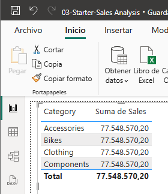

> [!NOTE]
> *El problema es que la tabla se basa en campos de diferentes tablas. Se espera que cada categoría de producto muestre las ventas de esa categoría. Sin embargo, como no hay una relación de modelo entre estas tablas, la tabla de ventas no está filtrada. Ahora añadirás una relación para propagar filtros entre las tablas.*

5. Para cambiar al diseñador de modelos, a la izquierda selecciona el **icono de vista de modelo**.

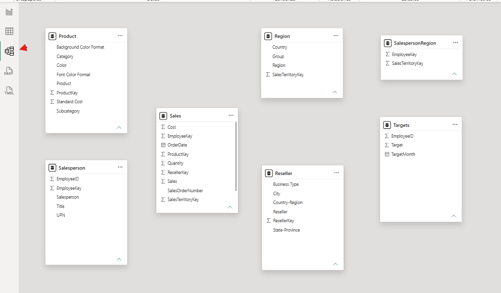

6. En la **cinta de Inicio**, selecciona **Administrar relaciones**.

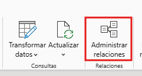

7. En la ventana **Administrar relaciones**, observa que aún no se definen relaciones.
8. Para crear una relación, selecciona **+ Nueva relación**.
9. Para configurar una relación de la tabla `Product` a la tabla `Sales`, en la lista desplegable de la tabla **Desde la tabla** selecciona `Product` y en la lista desplegable **A la tabla**, selecciona `Sales`.
10. Nótese que las siguientes propiedades se configuraron automáticamente:
    * **Se seleccionan las columnas ProductKey en cada tabla**: Las columnas se seleccionaron porque comparten el mismo nombre y tipo de datos. Puede que necesites encontrar columnas coincidentes con diferentes nombres en datos reales.
    * **El tipo de cardinalidad es Uno a Muchos (1:*)**: La cardinalidad se detectó automáticamente, porque Power BI entiende que la columna `ProductKey` de la tabla `Product` contiene valores únicos. Las relaciones de uno a muchos son la cardinalidad más común, y toda relación que crees en este laboratorio será de este tipo.
    * **El tipo de dirección de filtro cruzado es Único**: Dirección de filtro único significa que los filtros se propagan del "lado de uno" al "lado de muchos". En este caso, significa que los filtros aplicados a la tabla de productos se propagarán a la tabla de ventas, pero no en la dirección contraria.
    * **Activar esta relación está marcado**: Las relaciones activas propagan filtros. Es posible marcar una relación como inactiva para que los filtros no se propaguen. Las relaciones inactivas pueden existir cuando hay múltiples caminos de relación entre tablas. En este caso, los cálculos de modelos pueden usar funciones especiales para activarlas.

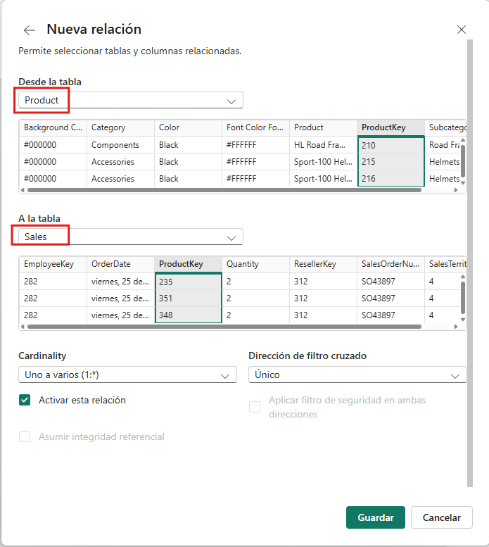

11. Selecciona **Guardar**, observa en la ventana **Administrar relaciones** que aparece la nueva relación y luego selecciona **Cerrar**.
12. En el diagrama del modelo, fíjate que ahora hay un conector entre las dos tablas (podrías elegir reposicionar las tablas para ver la relación con más claridad).

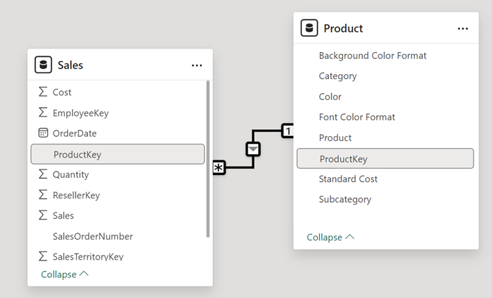

> [!NOTE]
> *Puedes interpretar muchas de las propiedades de la relación mirando la línea de la relación en el diagrama:*
* *La cardinalidad se representa mediante los indicadores **1** y *****.*
* *La dirección del filtro se representa con la punta de flecha.*
* *Una línea continua representa una relación activa; una línea punteada representa una relación inactiva.*

> [!TIP]
> *Si pasas el cursor sobre la relación se resaltan las columnas relacionadas.*

13. Cambia a la **vista de Informe** y luego observa que la imagen de la tabla se actualizó para mostrar valores diferentes para cada categoría de producto.

*Los filtros aplicados a la tabla de Producto ahora se propagan a la tabla de Ventas.*

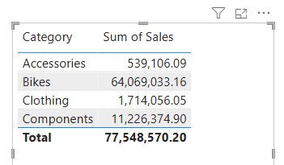

#### Crea relaciones adicionales

Hay una forma más sencilla de crear una relación. En el diagrama del modelo, puedes arrastrar y soltar columnas para crear una nueva relación.

1. Para crear una nueva relación usando una técnica diferente, cambia a la **vista de Modelo**.
2. Desde la tabla `Reseller`, arrastra la columna `ResellerKey` a la columna `ResellerKey` de la tabla `Sales`.
> [!IMPORTANT]
>  *A veces una columna no quiere arrastrarse. Si surge esta situación, selecciona otra columna, luego selecciona de nuevo la columna que quieres arrastrar, e inténtalo de nuevo. Asegúrate de ver la nueva relación añadida al diagrama.*

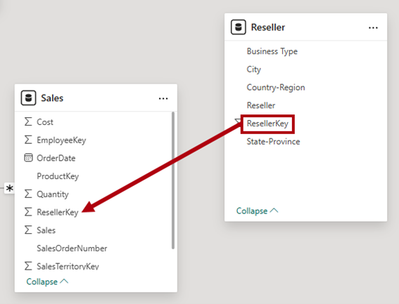

3. En la ventana **Nueva relación**, revisa la configuración y luego selecciona **Guardar**.
4. Utiliza la nueva técnica para crear las siguientes dos relaciones de modelo:
   * `Region | SalesTerritoryKey` a `Sales | SalesTerritoryKey`
   * `Salesperson | EmployeeKey` a `Sales | EmployeeKey`
5. En el diagrama, coloca las tablas de modo que la tabla `Sales` quede en el centro del diagrama y las tablas relacionadas estén dispuestas alrededor de ella. Coloca las tablas desconectadas a un lado.

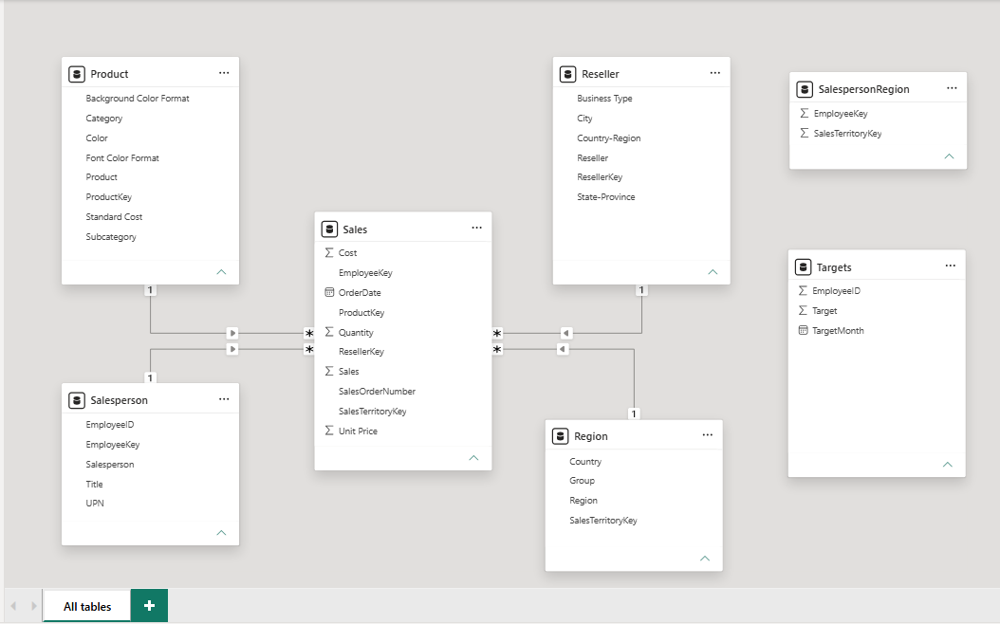

6. Guarda el archivo de Power BI Desktop.

---

### Bloque 2: Ergonomía del Modelo y Navegación Jerárquica

**Secciones del laboratorio incluidas:**
* Configure the Product table (Pasos 1 al 10).
* Configure the Region table (Pasos 1 al 3).
* Configure the Reseller table (Pasos 1 al 3).

**Puntos técnicos a ejecutar:**
* En `Product`: Crear la jerarquía `Products` (`Category` ➔ `Subcategory` ➔ `Product`) y crear la carpeta de visualización (*Display Folder*) `Formatting` con `Background Color Format` y `Font Color Format`.
* En `Region`: Crear la jerarquía `Regions` (`Group` ➔ `Country` ➔ `Region`) y asignar la categoría de datos de la columna `Country` a `Country/Region`.
* En `Reseller`: Crear las jerarquías `Resellers` (`Business Type` ➔ `Reseller`) y `Geography` (`Country-Region` ➔ `State-Province` ➔ `City` ➔ `Reseller`).
* En `Reseller`: Configurar las categorías geográficas de las columnas base `Country-Region` (`Country/Region`), `State-Province` (`State or Province`) y `City` (`City`).

#### Configurar la tabla de productos

En esta tarea, configurarás la tabla de `Product` con una jerarquía y una carpeta de visualización.

1. Cambiar a la **vista de Modelo**.
2. En el **panel de Datos**, si es necesario, amplía la tabla `Product` para revelar todos los campos.
3. En la tabla `Product`, haz clic derecho en la columna `Category` y selecciona **Crear jerarquía**.

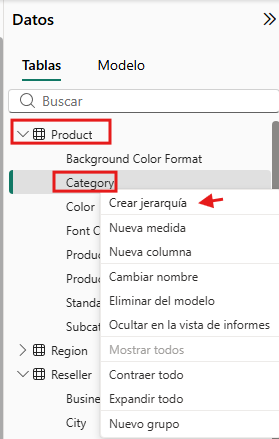

4. En el **panel de Propiedades**, en el cuadro de **Nombre**, sustituye el valor por *Products*.

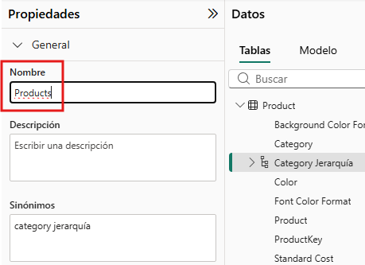

5. Para añadir niveles a la jerarquía, en la lista desplegable de **Jerarquía**, selecciona `Subcategory` y luego `Product` y después selecciona **Aplicar cambios en el nivel**.

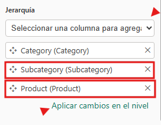

6. En el **panel de Datos**, fíjate en la jerarquía `Products`. Para revelar los niveles de jerarquía, amplíala.

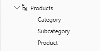

7. Para organizar las columnas en una carpeta de visualización, en el **panel de Datos**, primero selecciona la columna `Background Color Format`.
8. Mientras pulsas la tecla **Ctrl**, selecciona la columna `Font Color Format`.
9. En el **panel de Propiedades**, en el cuadro **Carpeta para mostrar**, introduce *Formatting*.

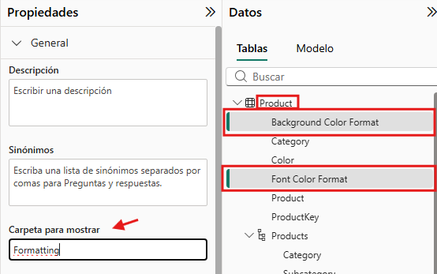

10. En el **panel de Datos**, observa que las dos columnas ahora están dentro de una carpeta.

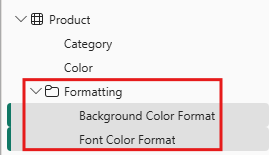

*Las carpetas de visualización son una excelente forma de organizar tablas, especialmente para tablas que comprenden muchos campos. Son solo para presentación lógica.*

#### Configurar la tabla de Regiones

En esta tarea, configurarás la tabla de `Region` con una jerarquía y categorías actualizadas.

1. En la tabla `Region`, crea una jerarquía llamada *Regions*, con los siguientes tres niveles:
   * `Group`
   * `Country`
   * `Region`
2. Selecciona la columna `Country` (no el nivel jerárquico de Country).
3. En el **panel de Propiedades**, expande la sección **Avanzado** (situada en la parte inferior del panel) y luego, en la lista desplegable de **Categoría de datos**, selecciona **País o región**.

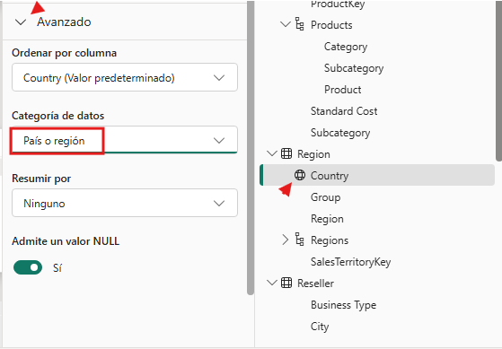

*La categorización de datos puede proporcionar pistas al diseñador del informe. En este caso, categorizar la columna como país o región proporciona información más precisa a Power BI cuando se realiza una visualización de mapa.*

#### Configurar la tabla de revendedores

En esta tarea, configurarás la tabla de `Reseller` para añadir una jerarquía y actualizar las categorías de datos.

1. En la tabla de `Reseller`, crea una jerarquía llamada *Resellers*, con los siguientes dos niveles:
   * `Business Type`
   * `Reseller`
2. Crear una segunda jerarquía llamada *Geography*, con los siguientes cuatro niveles:
   * `Country-Region`
   * `State-Province`
   * `City`
   * `Reseller`
3. Establece la categoría de datos para las siguientes columnas (que no estén dentro de la jerarquía):
   * `Country-Region` a **País o región** (*Country/Region*)
   * `State-Province` a **Estado o provincia** (*State or Province*)
   * `City` a **Ciudad** (*City*)

---

### Bloque 3: Optimización de Tipos, Formatos y Ocultación Técnica

**Secciones del laboratorio incluidas:**
* Configure the Sales table (Pasos 1 al 7).
* Bulk update properties (Pasos 1 al 5).
* Explore the model interface (Pasos 1 al 6).

**Puntos técnicos a ejecutar:**
* En `Sales`: Añadir la descripción *"Based on standard cost"* en `Cost`, activar el separador de miles en `Quantity`, fijar `Unit Price` con 2 decimales y su agregación por defecto en promedio (*Average*).
* Selección masiva y ocultación (*Is Hidden = Yes*) de las 13 columnas de claves técnicas y foráneas en múltiples tablas.
* Selección masiva y formato con 0 decimales para `Standard Cost`, `Cost` y `Sales`.
* Desactivar la configuración de Fecha/hora automática (*Auto Date/Time*) en las opciones del archivo actual para evitar jerarquías de fechas estándar que colisionan con el año fiscal de la empresa.

#### Configurar la tabla de ventas

En esta tarea, configurarás la tabla de `Sales` con descripciones actualizadas, formato y resumen.

1. En la tabla de `Sales`, selecciona la columna `Cost`.
2. En el **panel de Propiedades**, en el cuadro de **Descripción**, introduce: *Based on standard cost*.
> [!NOTE]
> *Las descripciones pueden aplicarse a tablas, columnas, jerarquías o medidas. En el panel de datos, el texto de la descripción se revela en una descripción emergente cuando el autor del informe pasa el cursor sobre el campo.*

3. Selecciona la columna `Quantity`.
4. En el **panel de Propiedades**, desde la sección de **Formato**, establece la propiedad **Separador de miles** en *Sí*.
5. Selecciona la columna `Unit Price`.
6. En el **panel de Propiedades**, desde la sección de **Formato**, establece la propiedad de **Decimales** en *2*.
7. En el grupo **Avanzado** (puede que necesites desplazarte hacia abajo para localizarlo), en la lista desplegable **Resumir por**, selecciona **Promedio**.

> [!NOTE]
> *Por defecto, las columnas numéricas se resumen sumando valores. Este comportamiento por defecto no es adecuado para una columna como Precio por Unidad, que representa una tasa. Poner el resumen por defecto en promedio producirá un resultado significativo.*

#### Propiedades de actualización masiva

En esta tarea, actualizarás varias columnas usando actualizaciones masivas individuales. Usarás este enfoque para ocultar columnas y formatear los valores de las columnas.

1. En el **panel de Datos** (o diagrama de modelo), selecciona la columna `Product | ProductKey`.
2. Mientras pulsas la tecla **Ctrl**, selecciona las siguientes 13 columnas (que abarcan varias tablas):
   * `Region | SalesTerritoryKey`
   * `Reseller | ResellerKey`
   * `Sales | EmployeeKey`
   * `Sales | ProductKey`
   * `Sales | ResellerKey`
   * `Sales | SalesOrderNumber`
   * `Sales | SalesTerritoryKey`
   * `Salesperson | EmployeeID`
   * `Salesperson | EmployeeKey`
   * `Salesperson | UPN`
   * `SalespersonRegion | EmployeeKey`
   * `SalespersonRegion | SalesTerritoryKey`
   * `Targets | EmployeeID`
3. En el **panel de Propiedades**, establece la propiedad **Está oculta** en *Sí*.

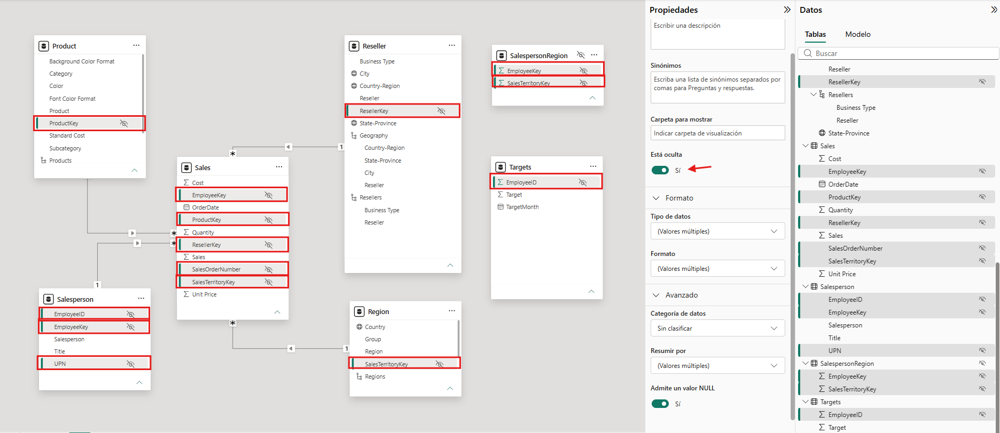

> [!NOTE]
> *Las columnas estaban ocultas porque son usadas por relaciones o se usarán en la lógica de configuración o cálculo de seguridad a nivel de fila.*
*Usarás la columna SalesOrderNumber en un cálculo en el laboratorio Crear Cálculos DAX en Power BI Desktop.*

4. Selecciona de forma múltiple las siguientes tres columnas:
   * `Product | Standard Cost`
   * `Sales | Cost`
   * `Sales | Sales`
5. En el **panel de Propiedades**, desde la sección de **Formato**, pon la propiedad de **Decimales** en *0* (cero).

#### Explora la interfaz del modelo

En esta tarea cambiarás a la **vista de informe**, revisarás la interfaz del modelo de datos y configurarás la opción automática de fecha/hora.

1. Cambia a la **vista de Informe**.
2. En el **panel de Datos**, observa lo siguiente:
   * Las columnas, jerarquías y sus niveles son campos que pueden usarse para configurar los visuales de los informes.
   * Solo se ven los campos relevantes para la redacción de informes.
   * La tabla `SalespersonRegion` no es visible, porque todos sus campos están ocultos.
   * Los campos espaciales en la tabla `Region` y `Reseller` están adornados con un icono espacial.
   * Los campos adornados con el símbolo sigma (Ʃ) se resumen por defecto.
   * Aparece una descripción emergente al pasar el cursor sobre el campo `Sales | Cost`.
3. Expande el campo `Sales | OrderDate`, y luego observa que revela una *Jerarquía de Fechas*. El campo `Targets | TargetMonth` ofrece una jerarquía similar.

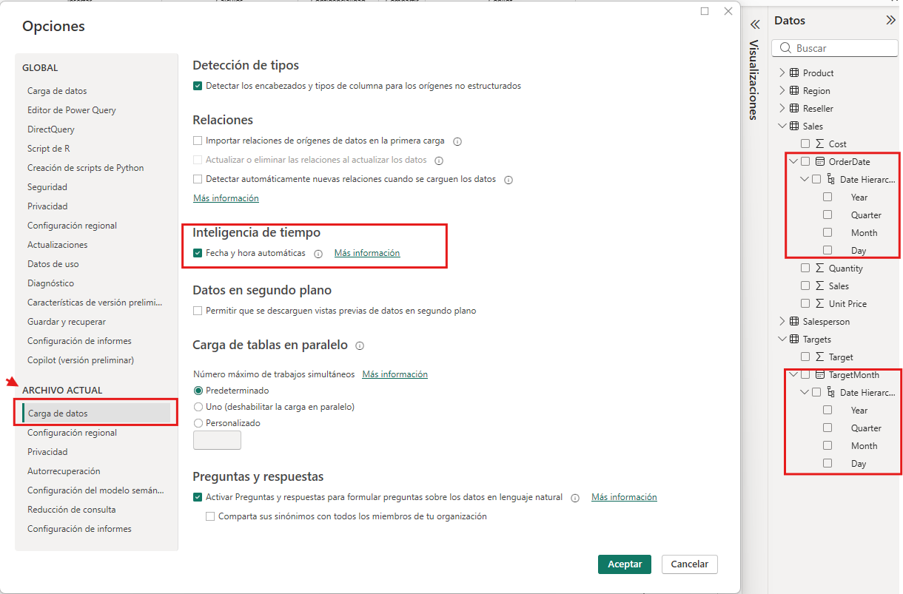

> [!IMPORTANT]
> ***Estas jerarquías no fueron creadas por ti. Se crearon automáticamente como configuración predeterminada. Sin embargo, hay un problema. El año fiscal de Adventure Works comienza el 1 de julio de cada año. Pero, en estas jerarquías de fechas creadas automáticamente, el año de jerarquía de fechas comienza el 1 de enero de cada año.***

4. Para desactivar la configuración automática de fecha/hora, navega a **Archivo > Opciones y configuración > Opciones**.
5. En la ventana de **Opciones**, en la sección **Archivo actual**, navega a **Carga de datos > Inteligencia temporal** y desmarca **Fecha/hora automática**.

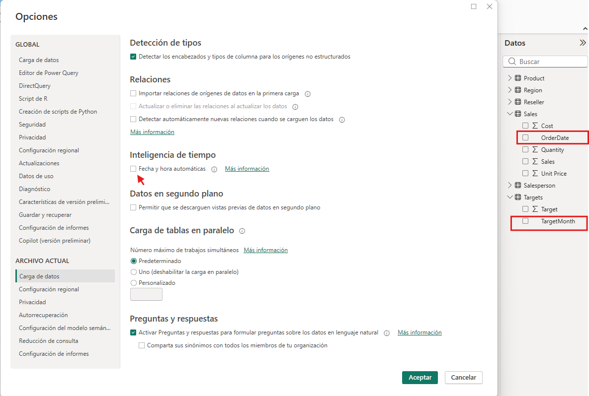

6. En el **panel de Datos**, observa que las jerarquías de fechas ya no están disponibles.

---

### Bloque 4: Capa de Métricas de Rentabilidad (Medidas Rápidas)

**Secciones del laboratorio incluidas:**
* Create quick measures (Pasos 1 al 13).

**Puntos técnicos a ejecutar:**
* Creación de la medida rápida de resta: `Sales` menos `Cost`, renombrada como `Profit`.
* Creación de la medida rápida de división: `Profit` entre `Sales`, renombrada como `Profit Margin` y formateada como porcentaje con 2 decimales.
* Incorporación de ambas medidas a la tabla visual del informe para validar los cálculos por categoría de producto.

#### Crea medidas rápidas

En esta tarea, crearás dos medidas rápidas para calcular el beneficio y el margen de beneficio. Una medida rápida crea la fórmula de cálculo para ti. Son fáciles y rápidas de crear para cálculos simples y comunes.

1. En el **panel de Datos**, haz clic derecho en la tabla de `Sales` y luego selecciona **Nueva medida rápida**.

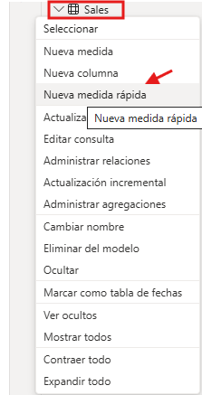

2. En el panel de **Medidas rápidas**, en la lista desplegable **Seleccionar un cálculo**, desde el grupo de **Operaciones matemáticas**, selecciona **Resta**.

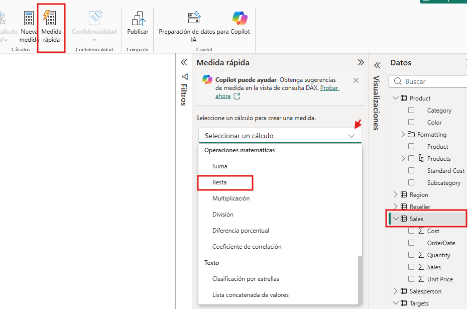

3. Desde el **panel de Datos**, arrastra el campo `Sales | Sales` al pozo de **Valor base**.
4. Arrastra el campo `Sales | Cost` en el cuadro **Valor para restar**.

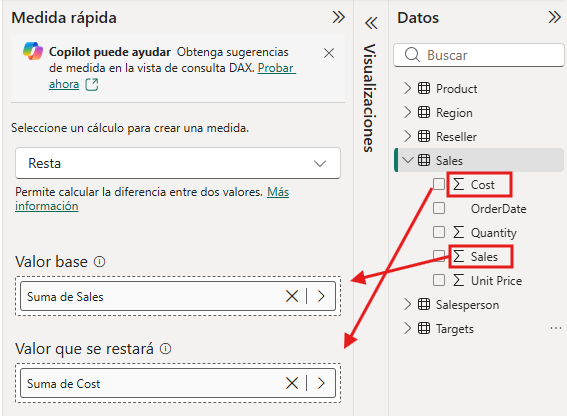

5. Selecciona **Añadir**.
6. En el **panel de Datos**, dentro de la tabla de `Sales`, observa la nueva medida.

*Las medidas se indican mediante el icono de la calculadora.*

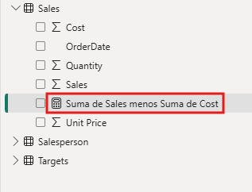

7. Para renombrar la medida, haz clic derecho en ella, selecciona **Renombrar** y luego renómbrala como *Profit*.

*Consejo: Para renombrar un campo, también puedes hacer doble clic en él, o seleccionarlo y pulsar F2.*

8. En la tabla de `Sales`, añade una segunda medida rápida, basada en los siguientes requisitos:

***Importante:*** *Si la opción de crear una medida rápida no aparece en el menú contextual, usa el comando que se encuentra en la cinta de inicio, desde dentro del grupo de Cálculos.*

* Utiliza la operación matemática de **División**.
* Ajusta el numerador al campo `Sales | Profit`.
* Pon el denominador en el campo `Sales | Sales`.
* Renombra la medida como *Profit Margin*.

9. Asegúrate de seleccionar la medida `Profit Margin` y, en la cinta contextual de **Herramientas de medición**, configura el formato en **Porcentaje**, con dos decimales.

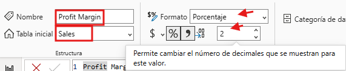

10. Para probar las dos medidas, primero selecciona la imagen de la tabla existente en la página.
11. En el **panel de Datos**, comprueba las medidas de `Profit` y `Profit Margin` para añadirlas a la tabla.

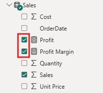

12. Selecciona y arrastra la guía derecha para ampliar la imagen de la tabla.

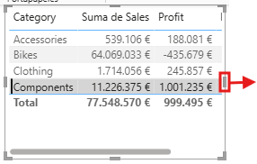

13. Verifica que las medidas produzcan resultados razonables y correctamente formateados.

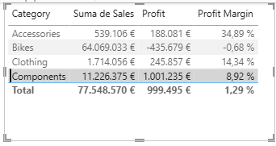

---

### Bloque 5: Resolución de Relaciones Muchos a Muchos y Rendimiento

**Secciones del laboratorio incluidas:**
* Create a many-to-many relationship (Pasos 1 al 22).
* Relate the Targets table (Pasos 1 al 3).
* Lab complete (Guardado final).

**Puntos técnicos a ejecutar:**
* Construcción del puente (*bridge table*) relacionando `Salesperson` con `SalespersonRegion` y `Region` con `SalespersonRegion`.
* Configuración del filtro cruzado en ambas direcciones (*Both*) y regla de seguridad bidireccional entre `Region` y `SalespersonRegion`.
* Desactivación intencionada de la relación directa `Salesperson` ➔ `Sales` para resolver la ambigüedad y forzar la propagación vía territorio.
* Renombrado de la tabla a `Salesperson (Performance)`.
* Creación de la relación entre `Salesperson (Performance) | EmployeeID` y `Targets | EmployeeID` y validación final de cuotas y ventas por comercial en la tabla de reporte.

#### Crea una relación de muchos a muchos

##### Paso 1: Crear el visual de rendimiento base

En esta tarea, crearás una relación de muchos a muchos entre la tabla de `Salesperson` y la tabla de `Sales`.

1. En la **vista de Informe**, selecciona un área en blanco de la página del informe.
2. Para crear una nueva tabla visual, en el **panel de Datos**, marca los siguientes dos campos:
   * `Salesperson | Salesperson`
   * `Sales | Sales`

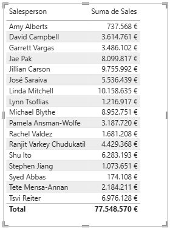

*La tabla visual muestra las ventas realizadas por cada vendedor. Sin embargo, existe otra relación entre los vendedores y las ventas. Algunos vendedores pertenecen a una, dos o posiblemente más regiones de ventas. Además, las regiones de ventas pueden tener varios comerciales asignados.*
*Desde la perspectiva de la gestión del rendimiento, las ventas de un comercial (basadas en los territorios asignados) deben analizarse y compararse con los objetivos de ventas. Crearás relaciones que respalden este análisis en el siguiente ejercicio.*

3. Fíjate en que *Michael Blythe* ha generado casi 9 millones de dólares en ventas.

##### Paso 2: Conectar la tabla puente

4. Cambia a la **vista de Modelo** y luego arrastra la tabla `SalespersonRegion` para colocarla entre las tablas `Region` y `Salesperson`.
5. Utiliza la técnica de arrastrar y soltar para crear las siguientes dos relaciones de modelo:
   * `Salesperson | EmployeeKey` para `SalespersonRegion | EmployeeKey`
   * `Region | SalesTerritoryKey` para `SalespersonRegion | SalesTerritoryKey`

*La tabla SalespersonRegion puede considerarse una tabla puente.*

6. Cambia a la **vista de Informe** y luego observa que el visual no se ha actualizado: el resultado de ventas de Michael Blythe no ha cambiado.

##### Paso 3: Configurar el filtro cruzado bidireccional

7. Vuelve a la **vista de Modelo** y luego sigue la dirección del filtro de relación (punta de flecha) desde la tabla de `Salesperson`.

*Considera que la tabla Salesperson filtra la tabla Sales. También filtra la tabla SalespersonRegion, pero no continúa propagando filtros a la tabla Region (la punta de flecha apunta en la dirección equivocada).*

8. Para editar la relación entre las tablas `Region` y `SalespersonRegion`, haz doble clic en la relación.
9. En la ventana **Editar relaciones**, en la lista desplegable **Dirección de filtro cruzado**, selecciona **Ambos**.
10. Marca la casilla **Aplicar filtro de seguridad en ambas direcciones**.

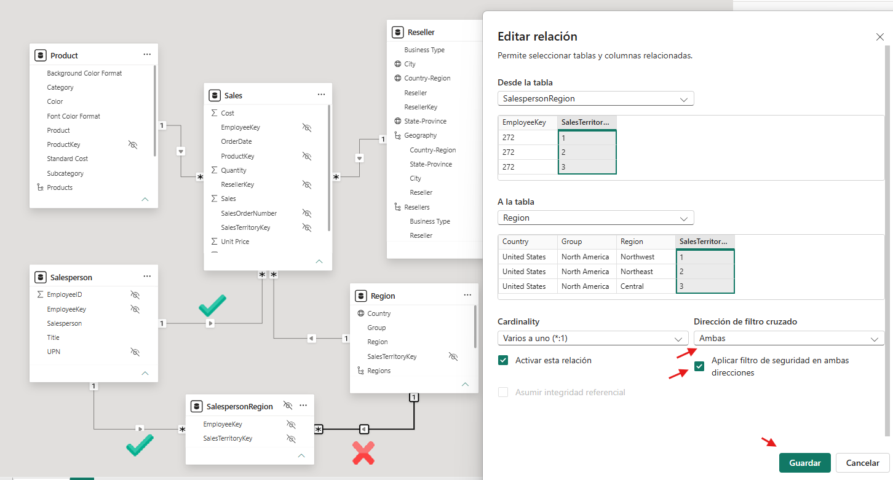

11. Selecciona **Guardar**.
12. Fíjate que la relación ahora tiene una doble punta de flecha.

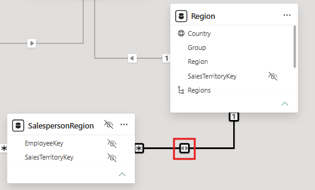

13. Cambia a la **vista de Informe** y luego observa que los valores de ventas siguen sin cambiar.

*El problema ahora se relaciona con el hecho de que existen dos posibles rutas de propagación de filtros entre las tablas de Vendedor y Ventas. Esta ambigüedad se resuelve internamente, basándose en una evaluación de "menor número de tablas". Para ser claros, no deberías diseñar modelos con este tipo de ambigüedad; el problema se abordará en parte más adelante en este laboratorio, y con la finalización del laboratorio Crear Cálculos DAX en Power BI Desktop.*

##### Paso 4: Desactivar la relación directa y renombrar

14. Cambia a la **vista de Modelo**.
15. Para forzar la propagación del filtro a través de la tabla puente, edita (haz doble clic) la relación entre las tablas de `Salesperson` y `Sales`.
16. En la ventana **Editar relaciones**, desmarca la casilla **Activar esta relación**.

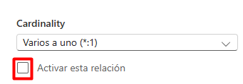

17. Selecciona **Guardar**.

*La propagación del filtro seguirá ahora el único camino activo.*

18. En el diagrama de modelos, observa que la relación inactiva se representa mediante una línea punteada.

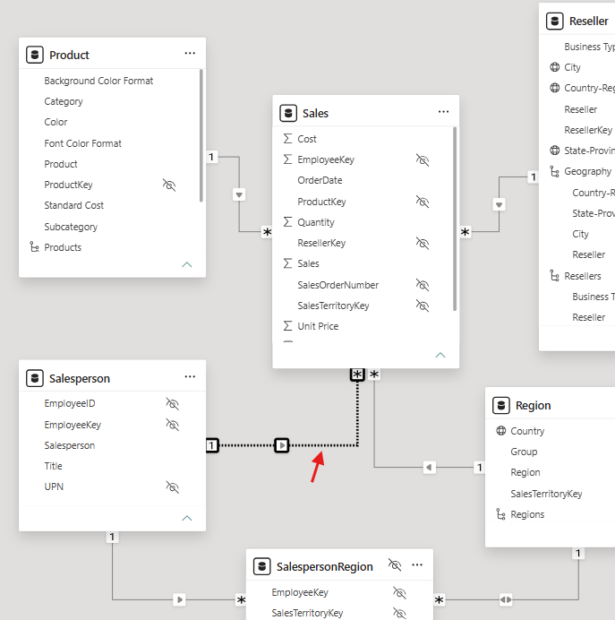

19. Cambia a la **vista de Informe** y entonces observa que las ventas de Michael Blythe son ahora casi 22 millones de dólares.

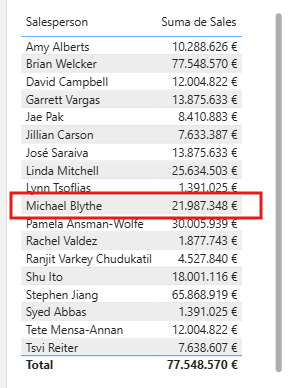

20. Fíjate también que las ventas de cada vendedor—si se añaden—superarían el total de la tabla.

*Es una observación común de una relación de muchos a muchos debido al doble, triple, etc., conteo de los resultados regionales de ventas. Pensemos en Brian Welcker, el segundo vendedor en la lista. Su cantidad de ventas equivale al total de ventas. Es el resultado correcto debido a que él es el Director de Ventas; sus ventas se miden por las ventas de todas las regiones.*
*Aunque la relación de muchos a muchos funciona ahora, ya no es posible analizar las ventas realizadas por un comercial (porque la relación está inactiva). Podrás reactivar la relación cuando introduzcas una tabla calculada que permita analizar las ventas realizadas en la(s) región(es) de ventas asignadas al comercial (para análisis de rendimiento) en el laboratorio Crear cálculos DAX en Power BI Desktop.*

21. Cambia a la **vista de Modelo** y, en el diagrama del modelo, selecciona la tabla de `Salesperson`.
22. En el **panel de Propiedades**, en el cuadro de **Nombre**, sustituye el texto por *Salesperson (Performance)*.

*La tabla renombrada ahora refleja su propósito: se utiliza para informar y analizar el rendimiento de los comerciales en función de las ventas de sus regiones de ventas asignadas.*

#### Relacionar la tabla de Objetivos

##### Paso 5: Vincular la tabla de objetivos Targets

En esta tarea, crearás una relación con la tabla de Objetivos.

1. Crea una relación desde la columna `Salesperson (Performance) | EmployeeID` y la columna `Targets | EmployeeID`.

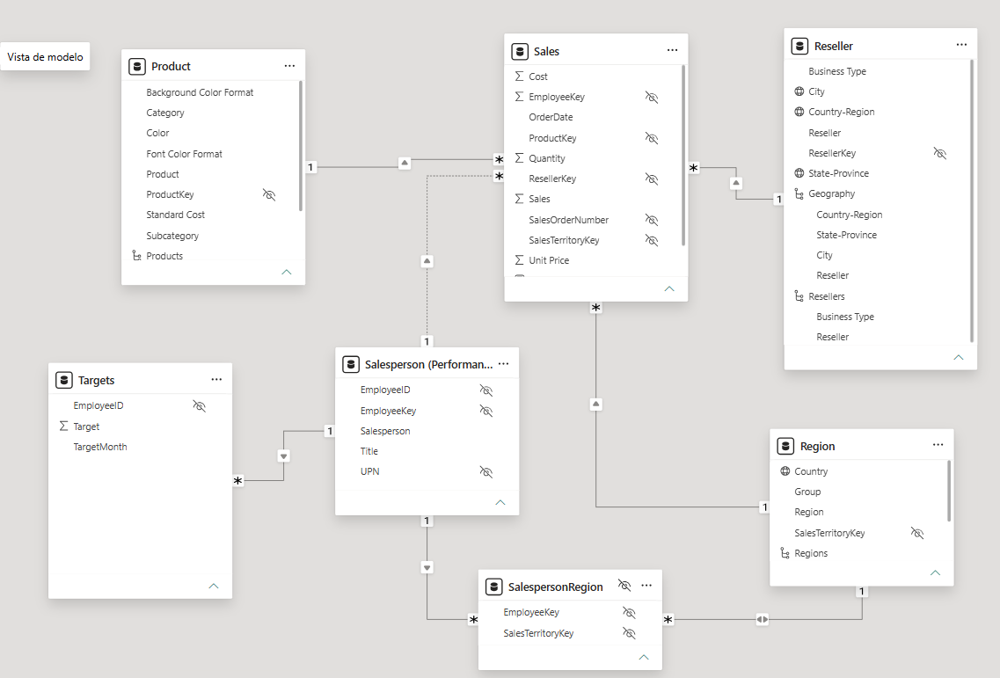

2. En la **vista de Informe**, añade el campo `Targets | Target` al objeto visual de la tabla.
3. Redimensiona la tabla visual para que todas las columnas sean visibles.

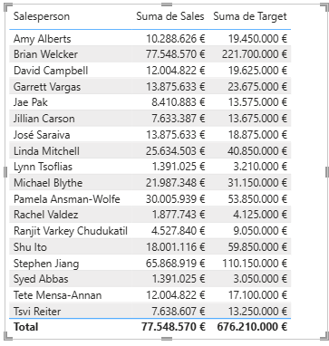

*Ahora es posible visualizar ventas y objetivos, pero por ahora ten cuidado por dos razones. Primero, no hay filtro en un periodo de tiempo, por lo que los objetivos también incluyen futuros importes objetivo. Segundo, los objetivos no son aditivos, por lo que el total no debería mostrarse. Pueden desactivarse formateando el visual o eliminarse usando lógica de cálculo.*

4. Guarda el archivo de Power BI Desktop.

### Laboratorio completo

Puedes optar por guardar tu informe de Power BI, aunque no es necesario para este laboratorio. En el siguiente ejercicio, trabajarás con un archivo inicial predefinido.

1. Ve al menú **"Archivo"** en la esquina superior izquierda y selecciona **"Guardar como"**.
2. Selecciona **Explorar este dispositivo**.
3. Selecciona la carpeta donde quieres guardar el archivo y ponle un nombre descriptivo.
4. Selecciona el botón **Guardar** para guardar tu informe como archivo .pbix.
5. Si aparece un cuadro de diálogo que te pide que apliques cambios pendientes en la consulta, selecciona **Aplicar**.
6. Cierra Power BI Desktop.

--------------------------------------------------------------------------------

## 🧠 Decisiones Técnicas Destacadas (Key Takeaways)
1.  **Filtro cruzado bidireccional en tablas puente:**  Se aplicó dirección de filtro cruzado en ambas direcciones ( *Both* ) junto con la regla de seguridad entre Region y SalespersonRegion para permitir que el filtro de vendedores alcance las ventas regionales.
2.  **Relación inactiva intencionada:**  La relación directa Salesperson $\rightarrow$ Sales se marca como inactiva para evitar caminos alternativos ( *loops* ) que el motor de Analysis Services resolvería de forma impredecible por distancia de saltos.

--------------------------------------------------------------------------------

## ✅ Lista de Verificación (Checklist)
*  [x] Esquema en estrella configurado con Sales como tabla de hechos central.
*  [x] Desactivada la opción de  *Auto Date/Time* .
*  [x] Jerarquías Products, Regions, Resellers y Geography creadas y verificadas.
*  [x] Carpetas de presentación ( *Formatting* ) aplicadas a campos de diseño.
*  [x] Ocultas las 13 claves técnicas del modelo.
*  [x] Medidas Profit y Profit Margin creadas con formato adecuado.
*  [x] Implementada la tabla puente SalespersonRegion con filtro bidireccional activado.
*  [x] Desactivada la relación directa entre vendedores y ventas.
*  [x] Capturas guardadas en la carpeta ./assets/.

--------------------------------------------------------------------------------

### 🧭 Navegación entre Laboratorios
| ⬅️ Laboratorio Anterior | 🏠 Índice de Laboratorios | ➡️ Siguiente Laboratorio |
| ------ | ------ | ------ |
| [Lab 02: Load and Transform Data in Power BI ](../02_clean_transform_and_load_data_in_power_bi/readme2.md) | [📚 Índice General PL-300 ](../../README.md) | [Lab 04: Create DAX Calculations in Power BI Desktop ](../04_create_dax_calculations_in_semantic_models/readme4.md) |

--------------------------------------------------------------------------------

*Documentación estructurada a partir del archivo de fuente readme4.md para el repositorio de evidencias PL-300.*
