### Lab 04: Create DAX Calculations in Power BI (PL-300)

Este repositorio contiene la guía de laboratorio, arquitectura de datos y plantilla de evidencias para el **Lab 04: Create DAX Calculations in Power BI** del curso **PL-300: Microsoft Power BI Data Analyst**.

---

#### 📑 Tabla de Contenidos
* [🎯 Objetivo y Lógica de Negocio](#-objetivo-y-lógica-de-negocio)
    * [Bloque 1: Tablas Calculadas y Relaciones Directas](#bloque-1-tablas-calculadas-y-relaciones-directas)
    * [Bloque 2: Columnas Calculadas, Ordenación Personalizada y Jerarquía Fiscal](#bloque-2-columnas-calculadas-ordenación-personalizada-y-jerarquía-fiscal)
    * [Bloque 3: Capa de Medidas Simples y Ergonomía del Modelo](#bloque-3-capa-de-medidas-simples-y-ergonomía-del-modelo)
    * [Bloque 4: Medidas Avanzadas y Control de Contexto de Evaluación](#bloque-4-medidas-avanzadas-y-control-de-contexto-de-evaluación)
* [📁 Estructura del Repositorio Recomendada](#-estructura-del-repositorio-recomendada)
* [🛠️ Tecnologías y Entorno](#️-tecnologías-y-entorno)
* [🛠️ Realización del Laboratorio](#️-realización-del-laboratorio)
* [📸 Arquitectura Final y Evidencias](#-arquitectura-final-y-evidencias)
* [🧠 Decisiones Técnicas Destacadas (Key Takeaways)](#-decisiones-técnicas-destacadas-key-takeaways)
* [✅ Lista de Verificación (Checklist)](#-lista-de-verificación-checklist)
* [🧭 Navegación entre Laboratorios](#-navegación-entre-laboratorios)

---

#### 🎯 Objetivo y Lógica de Negocio
El propósito de este laboratorio consiste en enriquecer el modelo semántico dimensional mediante el lenguaje **DAX (Data Analysis Expressions)**. Se crean tablas calculadas, columnas calculadas para soportar la inteligencia de tiempo fiscal, y medidas explícitas complejas que controlan la agregación en totales y organizan el catálogo métrico corporativo.

##### Bloque 1: Tablas Calculadas y Relaciones Directas
* **Objetivo:** Proporcionar perspectivas de análisis independientes para los vendedores (ventas directas vs. rendimiento territorial) y construir una dimensión de calendario en memoria.
* **Lógica de negocio:**
    * **Tabla calculada `Salesperson`:** Duplicación mediante DAX de `Salesperson (Performance)` para conectarla directamente con `Sales` mediante relación $1:*$, permitiendo evaluar ventas por comercial individual.
    * **Tabla calculada `Date`:** Generación automática del calendario continuo con `CALENDARAUTO(6)`, ajustando el cierre del año fiscal a junio para alinearse con el ejercicio financiero de Adventure Works.

##### Bloque 2: Columnas Calculadas, Ordenación Personalizada y Jerarquía Fiscal
* **Objetivo:** Habilitar el filtrado temporal por año fiscal, trimestre y mes, solucionando problemas de ordenación alfabética en visualizaciones.
* **Lógica de negocio:**
    * **Cálculo de año fiscal (`Year`):** Expresión DAX que suma 1 al año natural para fechas posteriores a junio (`FY2018`, `FY2019`, etc.).
    * **Clave de ordenación (`MonthKey`):** Generación de la columna numérica `(YEAR * 100) + MONTH` y aplicación de la propiedad **Ordenar por columna** (*Sort by Column*) sobre el campo `Month` para garantizar el orden cronológico fiscal.
    * **Jerarquía `Fiscal` y Marcado como Tabla de Fechas:** Estructuración de la jerarquía `Year` $\rightarrow$ `Quarter` $\rightarrow$ `Month` y declaración oficial de *Mark as Date Table* para asegurar el correcto funcionamiento de las funciones Time Intelligence.

##### Bloque 3: Capa de Medidas Simples y Ergonomía del Modelo
* **Objetivo:** Prevenir agregaciones implícitas incorrectas en informes (como la suma de precios unitarios) y centralizar los cálculos clave.
* **Lógica de negocio:**
    * **Ocultación de columnas numéricas:** Ocultación de `Unit Price` para forzar a los autores de informes a utilizar medidas DAX explícitas.
    * **Medidas explícitas de precios y recuentos:** Creación de `Avg Price`, `Median Price`, `Min Price`, `Max Price`, `Orders` (`DISTINCTCOUNT`) y `Order Lines` (`COUNTROWS`).
    * **Organización en carpetas de presentación:** Agrupación visual en carpetas `Pricing` y `Counts` con formato estandarizado (2 decimales y separador de miles).

##### Bloque 4: Medidas Avanzadas y Control de Contexto de Evaluación
* **Objetivo:** Evitar la suma inconsistente de objetivos de ventas en filas de total general y calcular métricas de desviación de cuotas.
* **Lógica de negocio:**
    * **Control de total con `HASONEVALUE`:** Evaluación del contexto mediante `HASONEVALUE('Salesperson (Performance)'[Salesperson])` para devolver el objetivo de cuota sólo cuando se filtra un único comercial, devolviendo `BLANK` en las filas de total.
    * **Medidas de desviación:** Implementación de `Variance = [Sum of Sales] - [Target]` y `Variance Margin = DIVIDE([Variance], [Target])`.
    * **Conversión a tabla de medidas:** Al ocultar `TargetAmount`, la tabla `Targets` se convierte en una tabla de medidas pura posicionándose en la parte superior del panel de datos.

---

#### 📁 Estructura del Repositorio Recomendada
```text
.
├── README.md                      # Documentación del laboratorio
├── pbix/
│   ├── 04-Starter-Sales Analysis.pbix
│   └── 04-Final-Sales Analysis.pbix  # Modelo con cálculos DAX
└── imagenes/                      # Capturas de pantalla de evidencia
    ├── lab4_img01.png
    ├── lab4_img02.png
    └── ...
```

---

#### 🛠️ Tecnologías y Entorno
* **Herramienta:** Microsoft Power BI Desktop
* **Lenguaje:** DAX (Data Analysis Expressions)
* **Funciones clave:** `CALENDARAUTO`, `YEAR`, `MONTH`, `AVERAGE`, `MEDIAN`, `MIN`, `MAX`, `DISTINCTCOUNT`, `COUNTROWS`, `HASONEVALUE`, `IF`, `DIVIDE`
* **Enfoque de diseño:** Tablas calculadas, medidas explícitas, carpetas de presentación, ordenación por columna clave.

---

#### 🛠️ Realización del Laboratorio

> 📑 **Índice Interno de Ejecución del Laboratorio (Bloques y Secciones)**
>
> * 📌 [**Historia del laboratorio**](#historia-del-laboratorio)
> * 📌 [**Empieza**](#empieza)
> * 🧩 [**Bloque 1: Tablas Calculadas y Relaciones Directas**](#bloque-1-tablas-calculadas-y-relaciones-directas)
>   * 🔹 [Crea la tabla calculada para Salesperson](#crea-la-tabla-calculada-para-salesperson)
>   * 🔹 [Crea la tabla de fechas](#crea-la-tabla-de-fechas)
> * 🧩 [**Bloque 2: Columnas Calculadas, Ordenación Personalizada y Jerarquía Fiscal**](#bloque-2-columnas-calculadas-ordenación-personalizada-y-jerarquía-fiscal)
>   * 🔹 [Crear columnas calculadas](#crear-columnas-calculadas)
>   * 🔹 [Completar la tabla de fechas](#completar-la-tabla-de-fechas)
>   * 🔹 [Marca la tabla de fechas](#marca-la-tabla-de-fechas)
> * 🧩 [**Bloque 3: Capa de Medidas Simples y Ergonomía del Modelo**](#bloque-3-capa-de-medidas-simples-y-ergonomía-del-modelo)
>   * 🔹 [Crea medidas simples](#crea-medidas-simples)
> * 🧩 [**Bloque 4: Medidas Avanzadas y Control de Contexto de Evaluación**](#bloque-4-medidas-avanzadas-y-control-de-contexto-de-evaluación)
>   * 🔹 [Crear medidas adicionales](#crear-medidas-adicionales)
>   * 🔹 [Laboratorio completo](#laboratorio-completo)

---

#### **Historia del laboratorio**

En este laboratorio, crearás tablas calculadas, columnas calculadas y medidas sencillas utilizando Expresiones de Análisis de Datos (DAX).

En este laboratorio, aprendes cómo:
* Crear tablas calculadas.
* Crear columnas calculadas.
* Crear medidas.

**Este laboratorio debería durar aproximadamente 45 minutos.**

#### **Empieza**

Para completar este ejercicio, descarga los recursos del laboratorio desde el repositorio oficial de Microsoft Learning para PL-300.
https://github.com/MicrosoftLearning/PL-300-Microsoft-Power-BI-Data-Analyst/raw/Main/Allfiles/Labs/04-create-dax-calculations\04-dax-calculations.zip

Extrae los archivos en la carpeta de trabajo del laboratorio.

Abre el archivo **04-Starter-Sales Analysis.pbix**.

> [!NOTE]
> Puede que veas un diálogo de inicio de sesión mientras carga el archivo. Selecciona **Cancelar** para cerrar el cuadro de inicio de sesión. Cierra cualquier otra ventana informativa. Selecciona **Solicitar más tarde**, si se le pide aplicar cambios.
---

### Bloque 1: Tablas Calculadas y Relaciones Directas

**Secciones del laboratorio incluidas:**
* Crea la tabla calculada para Salesperson (Pasos 1 al 10).
* Crea la tabla de fechas (Pasos 1 al 4).

**Puntos técnicos a ejecutar:**
* Creación de la tabla calculada `Salesperson = 'Salesperson (Performance)'` en DAX para permitir el análisis directo vendedor-ventas.
* Conexión de `Salesperson [EmployeeKey]` a `Sales [EmployeeKey]` mediante relación $1:*$ activa y eliminación de la relación inactiva antigua.
* Ocultación de claves técnicas (`EmployeeID`, `EmployeeKey`, `UPN`) y configuración de descripciones de tablas en el panel de propiedades.
* Generación de la tabla de calendario calculada `Date = CALENDARAUTO(6)` para abarcar años fiscales completos finalizados en junio.

#### Crea la tabla calculada para Salesperson

En esta tarea, crearás la tabla calculada `Salesperson` (que tendrá una relación directa con la tabla `Sales`).

Una tabla calculada se crea introduciendo primero el nombre de la tabla, seguido del símbolo de igual (`=`), seguido de una fórmula DAX que devuelve una tabla. El nombre de la tabla no puede existir ya en el modelo de datos.

1. En Power BI Desktop, en la vista de informes, en la cinta de **Modelado**, desde dentro del grupo de **Cálculos**, selecciona **Nueva tabla**.

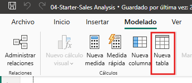

2. En la barra de fórmulas (que se abre justo debajo de la cinta cuando creas o editas cálculos), escribe el siguiente código DAX y pulsa **Enter**:

```dax
Salesperson = 'Salesperson (Performance)'
```

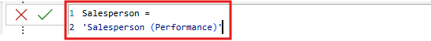

*Esta definición de tabla crea una copia de la tabla `Salesperson (Performance)`. Solo copia los datos; sin embargo, propiedades del modelo como visibilidad, formato y otras no se copian.*

3. En el panel de **Datos**, observa que el icono de la nueva tabla tiene una calculadora adicional delante (que indica una tabla calculada).

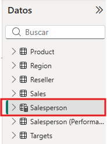

4. Cambia a la **vista de modelo** y observa que la tabla `Salesperson` está disponible.
5. Crea una relación entre la columna `Salesperson | EmployeeKey` y la columna `Sales | EmployeeKey`.
6. Haz clic derecho en la relación inactiva (línea de puntos) entre las tablas `Salesperson (Performance)` y `Sales` y luego selecciona **Eliminar**. Cuando se le pida confirmar la eliminación, seleccione **Sí**.
7. En la tabla `Salesperson`, selecciona las siguientes columnas y ocúltalas (establece **Está oculto** en **Sí**):
    * `EmployeeID`
    * `EmployeeKey`
    * `UPN`
8. En el diagrama del modelo, selecciona la tabla `Salesperson`.
9. En el panel de **Propiedades**, en el cuadro de **Descripción**, escribe: `Vendedor relacionado con ventas`.
10. Para la tabla `Salesperson (Performance)`, establece la descripción a: `Salesperson relacionado con region(es)`.

*El modelo de datos ahora ofrece dos alternativas al analizar a los vendedores. La tabla `Salesperson` permite analizar las ventas realizadas por un comercial, mientras que la tabla `Salesperson (Performance)` permite analizar las ventas realizadas en la(s) región(es) de ventas asignadas al comercial.*

#### Crea la tabla de fechas

En esta tarea, crearás la tabla `Date`.

1. Cambia a la **vista de tabla**. En la pestaña de la cinta de inicio, desde dentro del grupo de **Cálculos**, selecciona **Nueva tabla**.

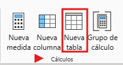

2. En la barra de fórmulas, introduce el siguiente DAX:

```dax
Date = CALENDARAUTO(6)
```

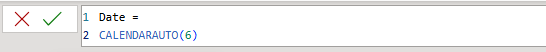

*La función `CALENDARAUTO` devuelve una tabla de una sola columna que incluye los valores de fechas. El comportamiento "auto" escanea todas las columnas de fecha del modelo de datos para determinar los valores de fecha más antiguo y más reciente almacenados en el modelo de datos. Luego crea una fila para cada fecha dentro de este rango, ampliando el rango en ambas direcciones para asegurar que se almacenen años completos de datos. El argumento `6` indica que junio es el último mes del año fiscal.*

3. Fíjate en la columna de valores de fecha que podría estar formateada usando configuraciones regionales.

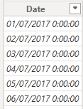

4. En la esquina inferior izquierda, en la barra de estado, observa las estadísticas de la tabla que confirman que se han generado 1,826 filas de datos, lo que representa datos de cinco años completos.

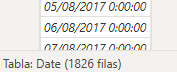
---

### Bloque 2: Columnas Calculadas, Ordenación Personalizada y Jerarquía Fiscal

**Secciones del laboratorio incluidas:**
* Crear columnas calculadas (Pasos 1 al 18).
* Completar la tabla de fechas (Pasos 1 al 7).
* Marca la tabla de fechas (Pasos 1 al 7).

**Puntos técnicos a ejecutar:**
* Creación de las columnas calculadas `Year`, `Quarter`, `Month` y la clave numérica `MonthKey`.
* Corrección del ordenamiento alfabético en el visual aplicando **Ordenar por columna** (*Sort by Column*) sobre `Month` utilizando `MonthKey`.
* Creación de la jerarquía fiscal `Fiscal` (`Year` $\rightarrow$ `Quarter` $\rightarrow$ `Month`) y ocultación de `MonthKey`.
* Marcado formal de la tabla como **Tabla de fechas** (*Mark as Date Table*) sobre `Date [Date]`.
* Vinculación de `Date [Date]` hacia `Sales [OrderDate]` y `Targets [TargetMonth]`, ocultando las claves originales.

#### Crear columnas calculadas

En esta tarea, añadirás más columnas para permitir el filtrado y agrupar por diferentes periodos de tiempo. También crearás una columna calculada para controlar el orden de ordenación de otras columnas.

1. En la cinta contextual de **Herramientas de Tabla**, desde dentro del grupo de **Cálculos**, selecciona **Nueva columna**.

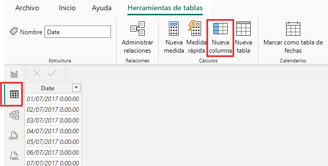

2. En la barra de fórmulas, escribe la siguiente fórmula DAX y pulsa **Enter**:

```dax
Year = "FY" & YEAR('Date'[Date]) + IF(MONTH('Date'[Date]) > 6, 1)
```


*La fórmula utiliza el valor anual de la fecha pero añade uno al valor del año cuando el mes es posterior a junio (inicio del año fiscal de Adventure Works).*

3. Crea las siguientes dos columnas calculadas para la tabla `Date`:

```dax
Quarter = 'Date'[Year] & " " & "Q" & IF(MONTH('Date'[Date]) <= 3, 3, IF(MONTH('Date'[Date]) <= 6, 4, IF(MONTH('Date'[Date]) <= 9, 1, 2)))
```

```dax
Month = FORMAT('Date'[Date], "yyyy MMM")
```

4. Verifica que se hayan añadido las nuevas columnas en la vista de tabla.

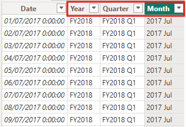

5. Para validar los cálculos, cambia a la **vista de informe**.
6. Para crear una nueva página de informe, selecciona el icono de más (`+`) junto a la Página 1.
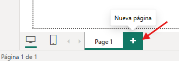


7. Para añadir una matriz visual a la nueva página de informe, en el panel de **Visualizaciones**, selecciona el tipo de matriz visual.

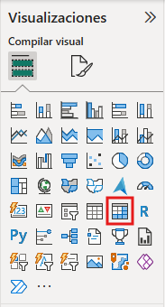


8. En el panel de datos, desde dentro de la tabla `Date`, arrastra el campo `Year` al área de **Filas**.

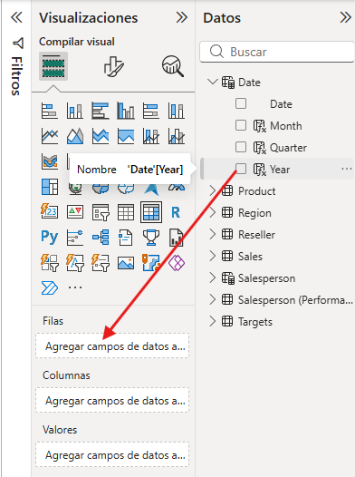


9. Arrastra el campo `Month` hacia el área de las **Filas**, justo debajo del campo `Year`.


10. En la parte superior derecha del visual de la matriz, selecciona el icono de doble flecha bifurcada (que expandirá todos los años un nivel hacia abajo).

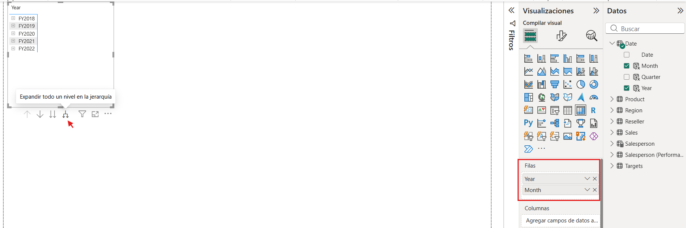


11. Fíjate que los años se expanden a meses, y que los meses están ordenados alfabéticamente en lugar de cronológicamente.

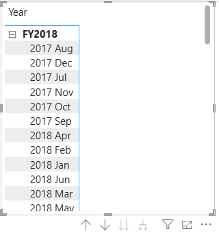


12. Para personalizar el orden de ordenación del campo `Month`, cambia a la **vista de tabla**.
13. Añade la columna `MonthKey` a la tabla `Date`:

```dax
MonthKey = (YEAR('Date'[Date]) * 100) + MONTH('Date'[Date])
```

14. En la **vista de tabla**, comprueba que la nueva columna contiene valores numéricos (por ejemplo, `201707` para julio de 2017).

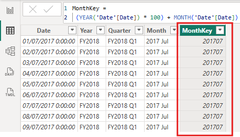


15. Vuelve a la **vista de informe**.
16. En el panel de datos, selecciona el campo `Month`.
17. En la cinta contextual de **Herramientas de Columna**, desde dentro del grupo **Ordenar**, selecciona **Ordenar por columna** y luego selecciona **MonthKey**.


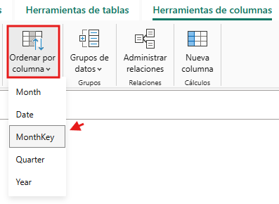

18. En la matriz visual, fíjate que los meses ahora están ordenados cronológicamente.

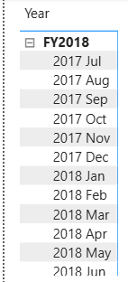

### Completar la tabla de fechas

En esta tarea, completarás el diseño de la tabla `Date` ocultando una columna y creando una jerarquía. Luego crearás relaciones con las tablas `Sales` y `Targets`.

1. Cambia a la **vista de modelo**.
2. En la tabla `Date`, oculta la columna `MonthKey` (establece **Está oculto** en **Sí**).
3. En el panel de Datos, selecciona la tabla `Date`, haz clic derecho en la columna `Year` y selecciona **Crear jerarquía**.

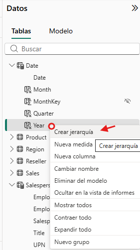

4. En el panel de **Propiedades**, en el cuadro de **Nombre**, sustituye el valor por **`Fiscal`**.


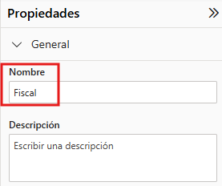


5. Añade dos niveles a la jerarquía: en la lista desplegable de la jerarquía, selecciona `Quarter` y luego `Month`. Después, haz clic en **Aplicar cambios de nivel**.

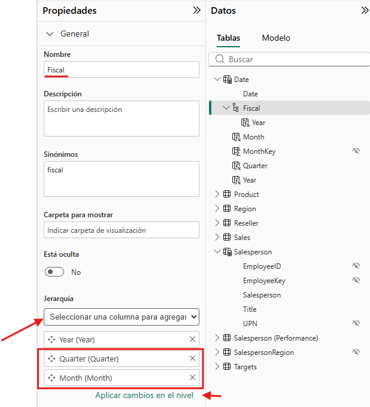


6. Crea las siguientes dos relaciones de modelo:
    * `Date | Date` a `Sales | OrderDate`
    * `Date | Date` a `Targets | TargetMonth`
7. Oculta las siguientes dos columnas:
    * `Sales | OrderDate`
    * `Targets | TargetMonth`

### Marca la tabla de fechas

En esta tarea, marcarás la tabla `Date` como una tabla de fechas oficial.

1. Cambia a la **vista de informe**.
2. En el panel de Datos, selecciona la tabla `Date` (no un campo individual).
3. En la cinta contextual de **Herramientas de Tablas**, desde el grupo **Calendarios**, selecciona **Marcar como Tabla de Fechas**.

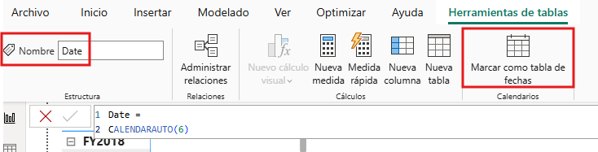


4. En la ventana **Marcar como tabla de fechas**, activa la propiedad **Marcar como tabla de fechas**.


5. En la lista desplegable **Elegir una columna de fecha**, selecciona **Date**.

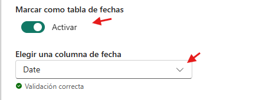


6. Selecciona **Guardar**.
7. Guarda el archivo de Power BI Desktop.

Power BI Desktop ahora entiende que esta tabla define la fecha (hora).

Este enfoque de diseño para una tabla de fechas es adecuado cuando no tienes una tabla de fechas en tu fuente de datos. Si tienes un almacén de datos, sería apropiado cargar datos de fechas desde su tabla de dimensiones de fechas en lugar de "redefinir" la lógica de fechas en tu modelo de datos.

---

## Bloque 3: Capa de Medidas Simples y Ergonomía del Modelo

**Secciones del laboratorio incluidas:**
* Crea medidas simples (Pasos 1 al 16).

**Puntos técnicos a ejecutar:**
* Demostración del comportamiento de agregación implícita en columnas numéricas y justificación de su ocultación.
* Creación de medidas explícitas en `Sales`: `Avg Price`, `Median Price`, `Min Price`, `Max Price`, `Orders` y `Order Lines`.
* Ocultación de la columna base `Unit Price`.
* Organización de medidas en las carpetas de presentación `Pricing` y `Counts`.
* Formato masivo (2 decimales y separadores de miles).

### Crea medidas simples

En esta tarea, crearás medidas sencillas. Las medidas simples agregan valores en una sola columna o cuentan filas de una tabla.

1. En la vista de informe, en la Página 2, desde el panel de datos, arrastra el campo `Sales | Unit Price` a la matriz visual.

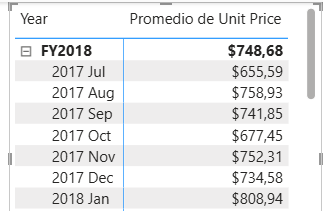

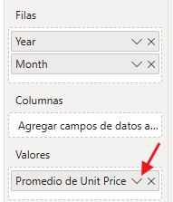

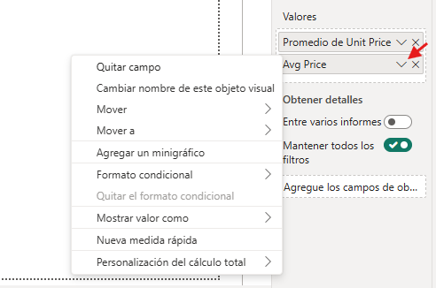

2. En el panel de campos visuales (ubicado en el panel de Visualizaciones), en el área de **Valores**, observa que el campo `Unit Price` está configurado como **Promedio del Precio Unitario**.

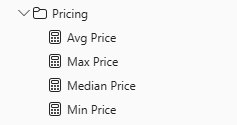

3. Selecciona la flecha hacia abajo para **Promedio de Precio Unitario** y observa las opciones disponibles en el menú.

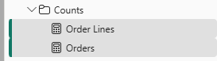

*Las columnas numéricas visibles permiten a los autores de informes decidir la agregación en tiempo de diseño. Para evitar cálculos inconsistentes, el enfoque recomendado es ocultar estas columnas y exponer medidas explícitas.*

4. Para crear una medida, en el panel de Datos, haz clic derecho en la tabla `Sales` y selecciona **Nueva medida**.
5. En la barra de fórmulas, añade la siguiente definición de medida:

```dax
Avg Price = AVERAGE(Sales[Unit Price])
```

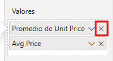

6. Añade la medida `Avg Price` a la matriz visual y observa que produce el mismo resultado que la columna `Unit Price`.
7. En el área de Valores, abre el menú contextual del campo `Avg Price` y observa que no es posible cambiar la técnica de agregación de una medida.
8. Crea las siguientes cinco medidas adicionales para la tabla `Sales`:

```dax
Median Price = MEDIAN(Sales[Unit Price])
```

```dax
Min Price = MIN(Sales[Unit Price])
```

```dax
Max Price = MAX(Sales[Unit Price])
```

```dax
Orders = DISTINCTCOUNT(Sales[SalesOrderNumber])
```

```dax
Order Lines = COUNTROWS(Sales)
```

9. Cambia a la **vista de modelo** y selecciona con `Ctrl` las cuatro medidas de precio: `Avg Price`, `Max Price`, `Median Price` y `Min Price`.
10. Para la selección múltiple de medidas:
    * Establece el formato con **2 decimales**.
    * Asigna la **Carpeta de presentación**: `Pricing`.

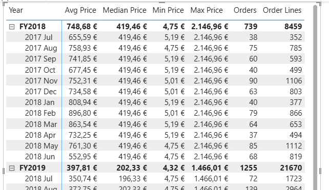

11. Oculta la columna `Unit Price`.
12. Selecciona las medidas `Order Lines` y `Orders` y configura:
    * Activa el **Separador de millares**.
    * Asigna la **Carpeta de presentación**: `Counts`.

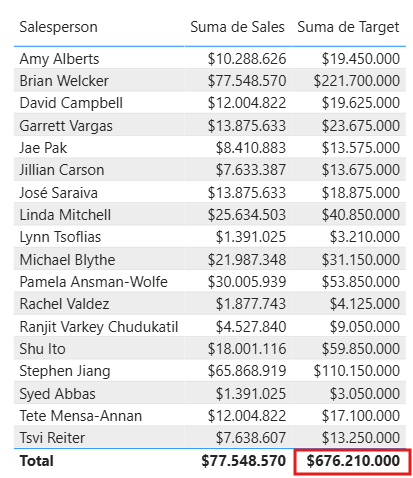

13. En la vista de informe, en el área de valores del gráfico matricial, elimina `Average of Unit Price`.
14. Aumenta el tamaño de la matriz visual.
15. Añade las cinco medidas a la matriz visual (`Median Price`, `Min Price`, `Max Price`, `Orders`, `Order Lines`).
16. Verifica que los resultados estén formateados correctamente.

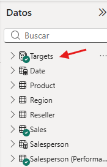

---

### Bloque 4: Medidas Avanzadas y Control de Contexto de Evaluación

**Secciones del laboratorio incluidas:**
* Crear medidas adicionales (Pasos 1 al 15).
* Laboratorio completo (Pasos 1 al 6).

**Puntos técnicos a ejecutar:**
* Detección del problema de agregación en totales con la columna de objetivos `TargetAmount`.
* Implementación de la medida `Target` utilizando `HASONEVALUE` para suprimir la suma en el total general.
* Creación de las medidas `Variance` y `Variance Margin`.
* Conversión de la tabla `Targets` en una **tabla de medidas** pura mediante la ocultación de `TargetAmount`.
* Validación final en el objeto visual de tabla.

#### Crear medidas adicionales

En esta tarea, crearás más medidas que usan fórmulas más complejas.

1. En la vista de informe, selecciona la Página 1 y revisa la imagen de la tabla de los vendedores (a la derecha), observando el total incorrecto de la columna **Suma de objetivos** ($676,210,000).

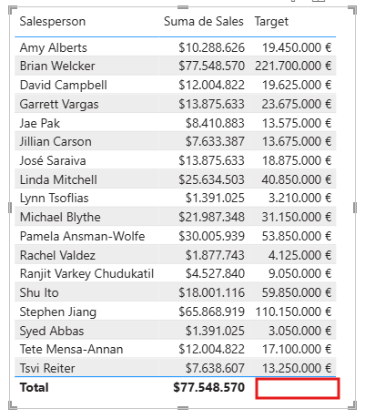

2. Selecciona la tabla visual y elimina **Suma de Objetivos**.
3. Renombra la columna `Targets | Target` como `TargetAmount`.
>[!TIP]
> Hay varias formas de renombrar la columna en la vista de informe: en el panel de Datos, puedes hacer clic derecho en la columna y luego seleccionar Renombrar—o hacer doble clic en la columna, o pulsar F2.

4. Crea la siguiente medida en la tabla `Targets`:

```dax
Target = 
IF(
    HASONEVALUE('Salesperson (Performance)'[Salesperson]),
    SUM(Targets[TargetAmount])
)
```

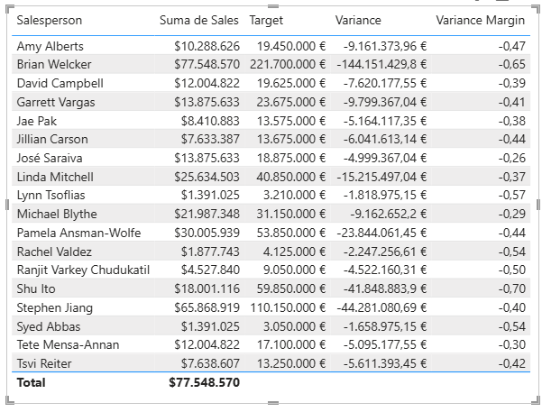

*La función `HASONEVALUE` evalúa si hay un único vendedor filtrado en el contexto. Si es verdadero, devuelve la suma de los objetivos del vendedor; si es falso (como en la fila de total), devuelve `BLANK`.*

5. Formatea la medida `Target` con **0 decimales**.
>[!TIP]
> Puedes usar la cinta contextual de **Herramientas de Medición.**

6. Oculta la columna `TargetAmount`.
>[!TIP] 
> Puedes hacer clic derecho en la columna del panel de **datos** y luego seleccionar **Ocultar**.

7. Añade la medida `Target` a la tabla visual.


>[!NOTE] 
> *Al contener sólo medidas visibles, la tabla `Targets` se mueve automáticamente a la parte superior de la lista en el panel de datos.*
8. Observa que el total de la columna Objetivo es ahora **`BLANK`**.


9. Crea las siguientes dos medidas para la tabla `Targets`:

```dax
Variance = [Sales] - [Target]
```

```dax
Variance Margin = DIVIDE([Variance], [Target])
```

10. Formatea `Variance` con **0 decimales**.
11. Formatea `Variance Margin` como **Porcentaje** con **2 decimales**.
12. Añade las medidas `Variance` y `Variance Margin` a la tabla visual.
13. Redimensiona la tabla para visualizar correctamente todas las filas y columnas.


14. Guarda el archivo de Power BI Desktop.

#### Laboratorio completo

1. Ve al menú **Archivo** y selecciona **Guardar como**.
2. Guarda el archivo como `04-Final-Sales Analysis.pbix`.
3. Cierra Power BI Desktop.

---

#### 📸 Arquitectura Final y Evidencias
* **Estado Inicial:** Modelo sin tablas calculadas de calendario ni medidas DAX explícitas (`./imagenes/lab04_start_dax_calc.jpg`).
* **Estado Final:** Modelo enriquecido con tabla de calendario fiscal, jerarquía `Fiscal`, medidas organizadas en carpetas de presentación (`Pricing`, `Counts`) y métricas de cuotas con control `HASONEVALUE` (`./imagenes/lab04_final_dax_calc.jpg`).

---

#### 🧠 Decisiones Técnicas Destacadas (Key Takeaways)
1. **Materialización de Tablas Calculadas:** La función `CALENDARAUTO(6)` genera y almacena datos en memoria dentro del modelo. Es ideal cuando el origen de datos carece de una dimensión de tiempo corporativa.
2. **Propiedad Ordenar por Columna (*Sort by Column*):** Los campos de texto como nombres de meses se ordenan alfabéticamente por defecto. Asignar la clave numérica `MonthKey` garantiza el orden cronológico fiscal en todos los informes.
3. **Control del Contexto en Totales (`HASONEVALUE`):** Previene la suma inconsistente de cuotas de ventas no aditivas devolviendo `BLANK` en agregaciones generales donde no hay un único vendedor seleccionado.
4. **Ergonomía mediante Tablas de Medidas Puras:** Ocultar todas las columnas implícitas convierte a una tabla en un contenedor exclusivo de medidas, reposicionándola automáticamente al principio del panel de Datos.

---

#### ✅ Lista de Verificación (Checklist)
* [x] Tabla calculada `Salesperson` creada y conectada directamente a `Sales`.
* [x] Tabla `Date` generada con `CALENDARAUTO(6)` y marcada oficialmente como Tabla de Fechas.
* [x] Columnas calculadas `Year`, `Quarter`, `Month` y `MonthKey` creadas.
* [x] Columna `Month` ordenada cronológicamente mediante `MonthKey`.
* [x] Jerarquía `Fiscal` configurada en la tabla `Date`.
* [x] Medidas simples de precios (`Avg Price`, `Median Price`, etc.) creadas y organizadas en la carpeta `Pricing`.
* [x] Medidas de recuento (`Orders`, `Order Lines`) creadas en la carpeta `Counts`.
* [x] Columna `Unit Price` ocultada para evitar sumas erróneas.
* [x] Medida `Target` implementada con `HASONEVALUE` para controlar totales vacíos.
* [x] Medidas `Variance` y `Variance Margin` calculadas e integradas en el informe.

---

#### 🧭 Navegación entre Laboratorios
| ⬅️ Laboratorio Anterior | 🏠 Índice General | ➡️ Siguiente Laboratorio |
| :--- | :---: | :--- |
| [Lab 03: Configure a Semantic Model in Power BI](../03_configure_a_semantic_model_in_power_bi/README.md) | [📚 Índice General PL-300](../../README.md) | [Lab 05: Modify DAX Filter Context in Power BI](../05_modify_dax_filter_context/README.md) |

---
*Documentación estructurada a partir del archivo oficial para el repositorio de evidencias PL-300.*