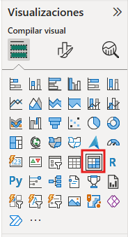
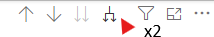
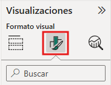
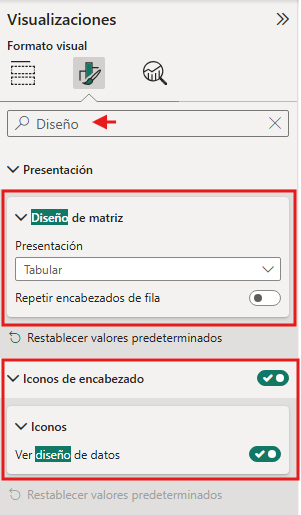
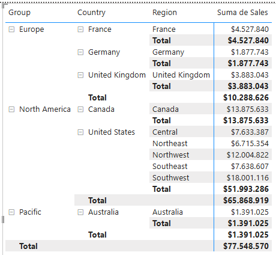
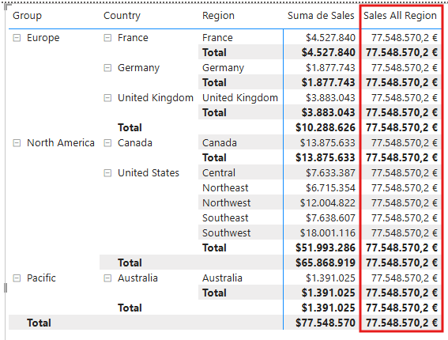
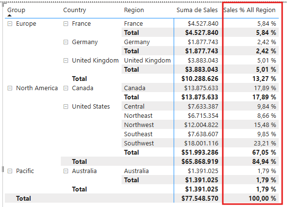
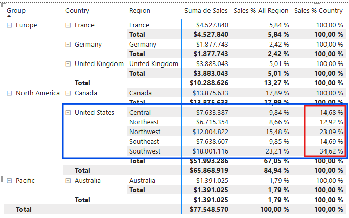
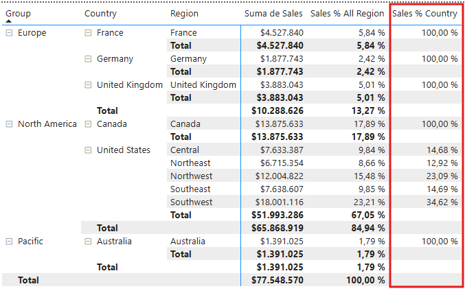
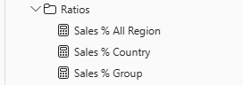

### Lab 05: Modify DAX Filter Context in Power BI (PL-300)

Este repositorio contiene la guía de laboratorio, arquitectura de datos y plantilla de evidencias para el **Lab 05: Modify DAX Filter Context in Power BI** del curso **PL-300: Microsoft Power BI Data Analyst**.

---

#### 📑 Tabla de Contenidos
* [🎯 Objetivo y Lógica de Negocio](#-objetivo-y-lógica-de-negocio)
    * [Bloque 1: Configuración de la Matriz Visual de Validación](#bloque-1-configuración-de-la-matriz-visual-de-validación)
    * [Bloque 2: Modificación del Contexto de Filtro con CALCULATE y REMOVEFILTERS](#bloque-2-modificación-del-contexto-de-filtro-con-calculate-y-removefilters)
* [📁 Estructura del Repositorio Recomendada](#-estructura-del-repositorio-recomendada)
* [🛠️ Tecnologías y Entorno](#️-tecnologías-y-entorno)
* [🛠️ Realización del Laboratorio](#️-realización-del-laboratorio)
* [📸 Arquitectura Final y Evidencias](#-arquitectura-final-y-evidencias)
* [🧠 Decisiones Técnicas Destacadas (Key Takeaways)](#-decisiones-técnicas-destacadas-key-takeaways)
* [✅ Lista de Verificación (Checklist)](#-lista-de-verificación-checklist)
* [🧭 Navegación entre Laboratorios](#-navegación-entre-laboratorios)

---

#### 🎯 Objetivo y Lógica de Negocio
El propósito de este laboratorio consiste en dominar la manipulación del **contexto de filtro** (*filter context*) en expresiones **DAX** utilizando las funciones `CALCULATE`, `REMOVEFILTERS` e `ISINSCOPE`. Se construyen métricas relativas escalonadas (porcentaje sobre total general, porcentaje sobre total país y porcentaje sobre total grupo) para permitir la navegación analítica jerárquica en los informes corporativos.

##### Bloque 1: Configuración de la Matriz Visual de Validación
* **Secciones del laboratorio incluidas:**
    * **Crear un objeto visual de matriz** (Pasos 1 al 10).
* **Puntos técnicos a ejecutar:**
    * Creación de un objeto visual de tipo Matriz (*Matrix*) en la Página 3 del informe.
    * Asignación de la jerarquía territorial `Region | Regions` al campo de Filas (*Rows*) y de la medida `Sales | Sales` al campo de Valores (*Values*).
    * Expansión multinivel de la jerarquía mediante la herramienta de bifurcación de flecha doble.
    * Configuración del formato de la matriz a diseño **Tabular** (*Tabular layout*) para mostrar las columnas independientes de `Group`, `Country` y `Region`.
* **Objetivo y Lógica de negocio:** Establecer un lienzo de pruebas estructurado y jerárquico que permita validar el comportamiento dinámico de los subtotales y totales generales al aplicar fórmulas DAX con alteración del contexto de filtro.

##### Bloque 2: Modificación del Contexto de Filtro con CALCULATE y REMOVEFILTERS
* **Secciones del laboratorio incluidas:**
    * **Manipular el contexto de filtro** (Pasos 1 al 19).
    * **Laboratorio completo** (Pasos 1 al 6).
* **Puntos técnicos a ejecutar:**
    * Creación de la medida `Sales % All Region` utilizando `DIVIDE` y `CALCULATE(SUM(Sales[Sales]), REMOVEFILTERS(Region))` para calcular la proporción sobre el total general (100%).
    * Creación de la medida `Sales % Country` eliminando únicamente los filtros de la columna individual `Region[Region]`.
    * Refinamiento de `Sales % Country` mediante la función de inspección de nivel `IF(ISINSCOPE(Region[Region]), ...)` para ocultar valores irrelevantes (100%) a niveles superiores.
    * Creación de la medida `Sales % Group` eliminando los filtros combinados de las columnas `Region[Region]` y `Region[Country]`.
    * Refinamiento de `Sales % Group` mediante `IF(ISINSCOPE(Region[Region]) || ISINSCOPE(Region[Country]), ...)` para controlar la visibilidad jerárquica.
    * Organización de todas las métricas relativas dentro de la carpeta de presentación `Ratios` en la tabla `Sales`.
    * Guardado final del informe como `05-Final-Sales Analysis.pbix`.
* **Objetivo y Lógica de negocio:** Calcular ratios de rendimiento acumulados y proporcionales sin romper la integridad del reporte, aplicando la eliminación selectiva de filtros para obtener denominadores estables según el nivel de agregación observado.

---

#### 📁 Estructura del Repositorio Recomendada
```text
.
├── README.md                      # Documentación del laboratorio
├── pbix/
│   ├── 05-Starter-Sales Analysis.pbix
│   └── 05-Final-Sales Analysis.pbix  # Modelo con manipulación de contexto DAX
└── imagenes/                      # Capturas de pantalla de evidencia
    ├── lab5_img01.png
    ├── lab5_img02.png
    └── ...
```

---

#### 🛠️ Tecnologías y Entorno
* **Herramienta:** Microsoft Power BI Desktop
* **Lenguaje:** DAX (Data Analysis Expressions)
* **Funciones clave:** `CALCULATE`, `REMOVEFILTERS`, `DIVIDE`, `IF`, `ISINSCOPE`
* **Enfoque de diseño:** Manipulación selectiva de contexto de filtro, ratios jerárquicos sobre totales y subtotales, organización en carpetas de presentación.

---

#### 🛠️ Realización del Laboratorio

> 📑 **Índice Interno de Ejecución del Laboratorio (Bloques y Secciones)**
>
> * 📌 [**Historia del laboratorio**](#historia-del-laboratorio)
> * 📌 [**Empieza**](#empieza)
> * 🧩 [**Bloque 1: Configuración de la Matriz Visual de Validación**](#bloque-1-configuración-de-la-matriz-visual-de-validación)
>   * 🔹 [Crear un objeto visual de matriz](#crear-un-objeto-visual-de-matriz)
> * 🧩 [**Bloque 2: Modificación del Contexto de Filtro con CALCULATE y REMOVEFILTERS**](#bloque-2-modificación-del-contexto-de-filtro-con-calculate-y-removefilters)
>   * 🔹 [Manipular el contexto de filtro](#manipular-el-contexto-de-filtro)
>   * 🔹 [Laboratorio completo](#laboratorio-completo)

---

#### **Historia del laboratorio**

En este laboratorio, crearás medidas con expresiones DAX que implican la manipulación del contexto de filtro.

En este laboratorio, aprendes cómo:
* Usar la función CALCULATE para manipular el contexto de filtro.

**Este laboratorio debería durar aproximadamente 30 minutos.**

#### **Empieza**

Para completar este ejercicio, descarga los recursos del laboratorio desde el repositorio oficial de Microsoft Learning para PL-300.

Extrae el archivo a la carpeta **C:\Users\Student\Downloads\05-modify-dax-filter-context**.

Abre el archivo **05-Starter-Sales Analysis.pbix**.

> [!NOTE]
> Puede que veas un diálogo de inicio de sesión mientras carga el archivo. Selecciona **Cancelar** para cerrar el cuadro de inicio de sesión. Cierra cualquier otra ventana informativa. Selecciona **Solicitar más tarde**, si se le pide aplicar cambios.

---

# Bloque 1: Configuración de la Matriz Visual de Validación

**Secciones del laboratorio incluidas:**
* **Crear un objeto visual de matriz** (Pasos 1 al 10).

**Puntos técnicos a ejecutar:**
* Creación de un objeto visual de tipo Matriz (*Matrix*) en la Página 3 del informe.
* Asignación de la jerarquía territorial `Region | Regions` al campo de Filas (*Rows*) y de la medida `Sales | Sales` al campo de Valores (*Values*).
* Expansión multinivel de la jerarquía mediante la herramienta de bifurcación de flecha doble.
* Configuración del formato de la matriz a diseño **Tabular** (*Tabular layout*) para mostrar las columnas independientes de `Group`, `Country` y `Region`.

## Crear un objeto visual de matriz

En esta tarea, crearás un objeto visual de matriz para apoyar la prueba de tus nuevas medidas.

1. En Power BI Desktop, crea una nueva página de informe (Página 3).
2. En la Página 3, añade un objeto visual de matriz.



3. Redimensiona el objeto visual de matriz para que ocupe toda la página.
4. Para configurar los campos del objeto visual de matriz, desde el panel de **Datos**, arrastra la jerarquía `Region | Regions` y suéltala dentro del objeto visual.

> [!NOTE]
> Los laboratorios usan una notación abreviada para referenciar un campo o jerarquía. Se verá así: `Region | Regions`. En este ejemplo, `Region` es el nombre de la tabla y `Regions` es el nombre de la jerarquía.

5. Añade el campo `Sales | Sales` al área de **Valores**.
6. Para expandir toda la jerarquía, en la esquina superior derecha del objeto visual de matriz, selecciona el icono de la flecha doble ramificada dos veces.



7. Para dar formato al objeto visual, en el panel de Visualizaciones, selecciona el panel de **Dar formato al objeto visual**.



8. En el cuadro de Búsqueda, escribe **Diseño** (*Layout*).
9. Establece la propiedad **Diseño de matriz** (*Matrix layout*) en **Tabular**.



10. Comprueba que el objeto visual de matriz tiene ahora 4 encabezados de columna.



*En Adventure Works, las regiones de ventas están organizadas en grupos, países y regiones. Todos los países, excepto Estados Unidos, tienen una sola región, que lleva el nombre del país. Como Estados Unidos es un territorio de ventas tan grande, se divide en cinco regiones de ventas.*

---

## Bloque 2: Modificación del Contexto de Filtro con CALCULATE y REMOVEFILTERS

**Secciones del laboratorio incluidas:**
* **Manipular el contexto de filtro** (Pasos 1 al 19).
* **Laboratorio completo** (Pasos 1 al 6).

**Puntos técnicos a ejecutar:**
* Creación de la medida `Sales % All Region` utilizando `DIVIDE` y `CALCULATE(SUM(Sales[Sales]), REMOVEFILTERS(Region))` para calcular la proporción sobre el total general (100%).
* Creación de la medida `Sales % Country` eliminando únicamente los filtros de la columna individual `Region[Region]`.
* Refinamiento de `Sales % Country` mediante la función de inspección de nivel `IF(ISINSCOPE(Region[Region]), ...)` para ocultar valores irrelevantes (100%) a niveles superiores.
* Creación de la medida `Sales % Group` eliminando los filtros combinados de las columnas `Region[Region]` y `Region[Country]`.
* Refinamiento de `Sales % Group` mediante `IF(ISINSCOPE(Region[Region]) || ISINSCOPE(Region[Country]), ...)` para controlar la visibilidad jerárquica.
* Organización de todas las métricas relativas dentro de la carpeta de presentación `Ratios` en la tabla `Sales`.
* Guardado final del informe como `05-Final-Sales Analysis.pbix`.

### Manipular el contexto de filtro

En esta tarea, crearás varias medidas con expresiones DAX que utilizan la función CALCULATE para manipular el contexto de filtro.

La función `CALCULATE` es una función potente que puedes usar para manipular el contexto de filtro. El primer argumento toma una expresión o una medida (una medida es solo una expresión con nombre). Los argumentos posteriores permiten modificar el contexto de filtro.

1. Añade una medida a la tabla `Sales`, basada en la siguiente expresión:

> [!NOTE]
> Para tu comodidad, todas las definiciones DAX de este laboratorio se pueden copiar del archivo `Snippets.txt` incluido en los recursos del laboratorio.

```dax
Sales All Region =
CALCULATE(
    SUM(Sales[Sales]),
    REMOVEFILTERS(Region)
)
```

*La función `REMOVEFILTERS` elimina los filtros activos. Puede no tomar argumentos, o tomar una tabla, una columna o múltiples columnas como argumento. En esta fórmula, la medida evalúa la suma de la columna Sales en un contexto de filtro modificado, que elimina cualquier filtro aplicado a las columnas de la tabla Region.*

2. Añade la medida `Sales All Region` al objeto visual de matriz.



3. Observa que la medida calcula el total de todas las ventas de la región para cada región, país (subtotal) y grupo (subtotal).

*La nueva medida aún no ofrece un resultado útil. Cuando las ventas de un grupo, país o región se dividen por este valor, se producirá un ratio útil conocido como "porcentaje del total general".*

4. En el panel de Datos, asegúrate de que la medida `Sales All Region` está seleccionada y, en la barra de fórmulas, reemplaza el nombre y la fórmula con la siguiente expresión:

> [!TIP]
> Para reemplazar la fórmula existente, primero copia el fragmento. Luego, selecciona dentro de la barra de fórmulas y presiona Ctrl+A para seleccionar todo el texto. Después, presiona Ctrl+V para pegar el fragmento y sobrescribir el texto. Por último, presiona Enter.

```dax
Sales % All Region =
DIVIDE(
    SUM(Sales[Sales]),
    CALCULATE(
        SUM(Sales[Sales]),
        REMOVEFILTERS(Region)
    )
)
```

*La medida ha sido renombrada para reflejar con precisión la fórmula actualizada. La función `DIVIDE` divide la suma de la columna Sales (no modificada por el contexto de filtro) entre la suma de la columna Sales en un contexto modificado, que elimina cualquier filtro aplicado a la tabla Region.*

5. En el objeto visual de matriz, observa que la medida ha sido renombrada y que ahora aparece un valor diferente para cada grupo, país y región.
6. Da formato a la medida `Sales % All Region` como porcentaje con dos decimales.
7. En el objeto visual de matriz, revisa los valores de la medida `Sales % All Region`.



8. Añade otra medida a la tabla `Sales`, basada en la siguiente expresión, y dale formato de porcentaje:

```dax
Sales % Country =
DIVIDE(
    SUM(Sales[Sales]),
    CALCULATE(
        SUM(Sales[Sales]),
        REMOVEFILTERS(Region[Region])
    )
)
```

9. Observa que la fórmula de la medida `Sales % Country` difiere ligeramente de la fórmula de la medida `Sales % All Region`.

*La diferencia es que el denominador modifica el contexto de filtro eliminando los filtros en la columna `Region` de la tabla `Region`, no en todas las columnas de la tabla `Region`. Eso significa que cualquier filtro aplicado a las columnas de grupo o país se conserva. Conseguirá un resultado que representa las ventas como un porcentaje del país.*

10. Añade la medida `Sales % Country` al objeto visual de matriz.
11. Observa que solo las regiones de Estados Unidos producen un valor que no es el 100 por ciento.



*Recordemos que solo Estados Unidos tiene múltiples regiones. Todos los demás países comprenden una sola región, lo que explica por qué todos son el 100 por ciento.*

12. Para mejorar la legibilidad de esta medida en el visual, sobrescribe la medida `Sales % Country` con la siguiente fórmula mejorada:

```dax
Sales % Country =
IF(
    ISINSCOPE(Region[Region]),
    DIVIDE(
        SUM(Sales[Sales]),
        CALCULATE(
            SUM(Sales[Sales]),
            REMOVEFILTERS(Region[Region])
        )
    )
)
```

*La función `IF` usa la función `ISINSCOPE` para probar si la columna de región es el nivel en una jerarquía de niveles. Cuando es verdadero, se evalúa la función `DIVIDE`. Cuando es falso, se devuelve `BLANK` porque la columna de región no está en el ámbito.*

13. Observa que la medida `Sales % Country` ahora solo devuelve un valor cuando una región está en el ámbito.



14. Añade otra medida a la tabla `Sales`, basada en la siguiente expresión, y dale formato de porcentaje con dos decimales:

```dax
Sales % Group =
DIVIDE(
    SUM(Sales[Sales]),
    CALCULATE(
        SUM(Sales[Sales]),
        REMOVEFILTERS(
            Region[Region],
            Region[Country]
        )
    )
)
```

*Para conseguir las ventas como un porcentaje del grupo, se pueden aplicar dos filtros para eliminar eficazmente los filtros de dos columnas.*

15. Añade la medida `Sales % Group` al objeto visual de matriz.
16. Para mejorar la legibilidad de esta medida en el visual, sobrescribe la medida `Sales % Group` con la siguiente fórmula:

```dax
Sales % Group =
IF(
    ISINSCOPE(Region[Region]) || ISINSCOPE(Region[Country]),
    DIVIDE(
        SUM(Sales[Sales]),
        CALCULATE(
            SUM(Sales[Sales]),
            REMOVEFILTERS(
                Region[Region],
                Region[Country]
            )
        )
    )
)
```

17. Observa que la medida `Sales % Group` ahora solo devuelve un valor cuando una región o país está en el ámbito.



18. En la **Vista de modelo**, coloca las tres nuevas medidas en una carpeta de presentación llamada **Ratios**.


19. Guarda el archivo de Power BI Desktop.

*Las medidas añadidas a la tabla `Sales` han modificado el contexto de filtro para lograr una navegación jerárquica. Observa que el patrón para lograr el cálculo de un subtotal requiere eliminar algunas columnas del contexto de filtro, y para llegar a un total general, se deben eliminar todas las columnas.*

### Laboratorio completo

Puedes optar por guardar tu informe de Power BI, aunque no es necesario para este laboratorio. En el siguiente ejercicio, trabajarás con un archivo inicial predefinido.

1. Ve al menú **Archivo** en la esquina superior izquierda y selecciona **Guardar como**.
2. Selecciona **Explorar este dispositivo**.
3. Selecciona la carpeta donde quieres guardar el archivo y ponle un nombre descriptivo (`05-Final-Sales Analysis.pbix`).
4. Selecciona el botón **Guardar** para guardar tu informe como archivo .pbix.
5. Si aparece un cuadro de diálogo que te pide que apliques cambios pendientes en la consulta, selecciona **Aplicar**.
6. Cierra Power BI Desktop.

---

## 📸 Arquitectura Final y Evidencias
* **Captura del Modelo y Ratios:**
  
* **Visual de Matriz Configurado:** Matriz multinivel con columnas de porcentaje sobre el total regional (`Sales % All Region`), porcentaje país (`Sales % Country`) y porcentaje grupo (`Sales % Group`) formateadas correctamente sin redundancias a niveles superiores.

---

## 🧠 Decisiones Técnicas Destacadas (Key Takeaways)
1. **Poder de `CALCULATE` y `REMOVEFILTERS`:** `CALCULATE` evalúa una expresión en un contexto de filtro modificado. La función `REMOVEFILTERS` permite eliminar selectivamente filtros de tablas completas o columnas específicas, facilitando la construcción de denominadores fijos para ratios.
2. **Inspección de Nivel Jerárquico con `ISINSCOPE`:** Evita la visualización de valores insustanciales (como 100%) en niveles agregados de jerarquías. Al evaluar si una columna específica está en el ámbito activo de la matriz, devuelve `BLANK` para limpiar el objeto visual.
3. **Control Gradual de Filtros por Columna:** Mientras que `REMOVEFILTERS(Region)` borra todos los filtros de la tabla territorial, `REMOVEFILTERS(Region[Region])` borra únicamente el filtro del nivel de región individual, preservando el contexto del grupo y del país.

---

## ✅ Lista de Verificación (Checklist)
* [x] Objeto visual de matriz configurado con diseño tabular y jerarquía `Region | Regions` expandida.
* [x] Medida `Sales % All Region` creada con `REMOVEFILTERS(Region)` y formateada como porcentaje (2 decimales).
* [x] Medida `Sales % Country` configurada con `REMOVEFILTERS(Region[Region])` e `ISINSCOPE(Region[Region])`.
* [x] Medida `Sales % Group` configurada con `REMOVEFILTERS(Region[Region], Region[Country])` y control de ámbito mediante `ISINSCOPE`.
* [x] Las 3 medidas de ratios agrupadas en la carpeta de presentación `Ratios` dentro de la tabla `Sales`.
* [x] Informe guardado como `05-Final-Sales Analysis.pbix`.

---

### 🧭 Navegación entre Laboratorios
| ⬅️ Laboratorio Anterior | 🏠 Índice de Laboratorios | ➡️ Siguiente Laboratorio |
| :--- | :---: | :--- |
| [Lab 04: Create DAX Calculations in Power BI<br>](../04_create_dax_calculations_in_semantic_models/04_create_dax_calculations_in_semantic_models.md) | [📚 Índice General PL-300<br>](../../README.md) | [Lab 06: Use DAX Time Intelligence in Power BI<br>](../06_use_dax_time_intelligence_in_power_bi/06_use_dax_time_intelligence_in_power_bi.md) |

---
