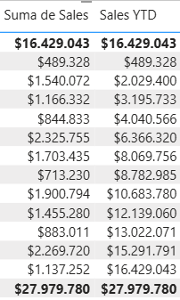
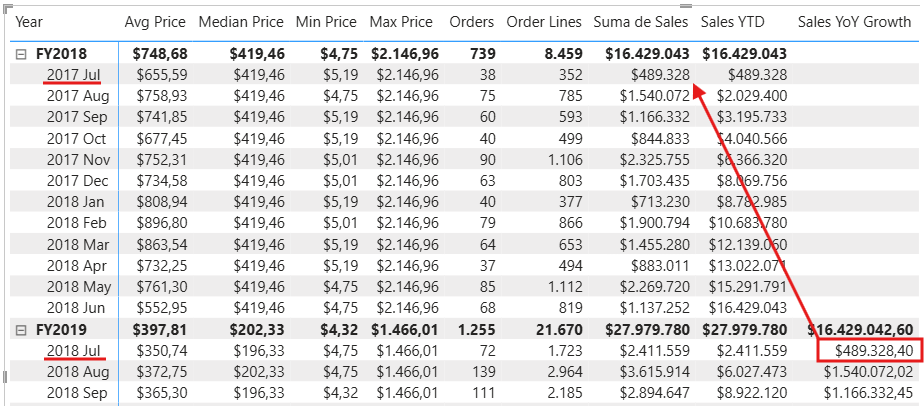
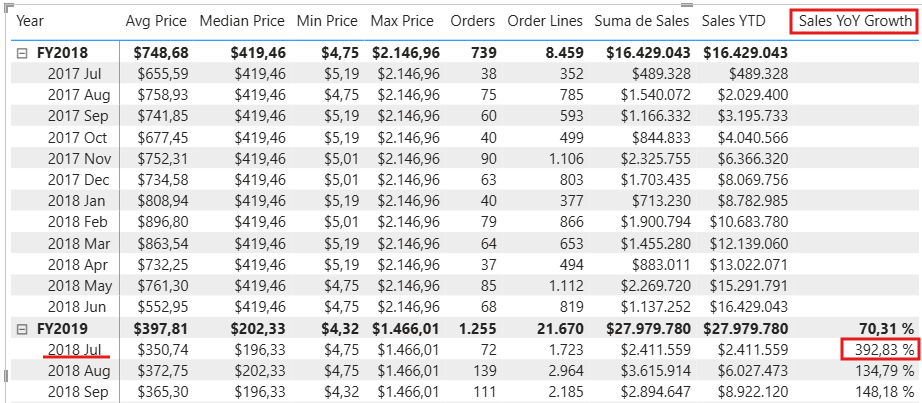
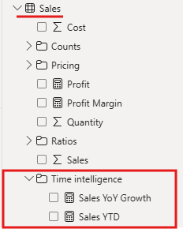

# Lab 06: Use DAX Time Intelligence Functions in Power BI (PL-300)

Este repositorio contiene la guía de laboratorio, arquitectura de datos y plantilla de evidencias para el **Lab 06: Use DAX Time Intelligence Functions in Power BI** del curso **PL-300: Microsoft Power BI Data Analyst**.

---

## 📑 Tabla de Contenidos
* [🎯 Objetivo y Lógica de Negocio](#-objetivo-y-lógica-de-negocio)
    * [Bloque 1: Acumulados Anuales y Manipulación de Filtros Temporales (YTD)](#bloque-1-acumulados-anuales-y-manipulación-de-filtros-temporales-ytd)
    * [Bloque 2: Análisis Comparativo Interanual con Variables y Funciones de Desplazamiento (YoY Growth)](#bloque-2-análisis-comparativo-interanual-con-variables-y-funciones-de-desplazamiento-yoy-growth)
* [📁 Estructura del Repositorio Recomendada](#-estructura-del-repositorio-recomendada)
* [🛠️ Tecnologías y Entorno](#️-tecnologías-y-entorno)
* [🛠️ Realización del Laboratorio](#️-realización-del-laboratorio)
* [📸 Arquitectura Final y Evidencias](#-arquitectura-final-y-evidencias)
* [🧠 Decisiones Técnicas Destacadas (Key Takeaways)](#-decisiones-técnicas-destacadas-key-takeaways)
* [✅ Lista de Verificación (Checklist)](#-lista-de-verificación-checklist)
* [🧭 Navegación entre Laboratorios](#-navegación-entre-laboratorios)

---

## 🎯 Objetivo y Lógica de Negocio
El propósito de este laboratorio consiste en implementar métricas de **inteligencia de tiempo (*Time Intelligence*)** en lenguaje **DAX** para analizar la evolución temporal de las ventas. Se crean medidas acumuladas anuales adaptadas al calendario fiscal corporativo de Adventure Works y se calculan tasas de crecimiento interanual (*Year-Over-Year*) mediante variables y funciones de desplazamiento temporal.

### Bloque 1: Acumulados Anuales y Manipulación de Filtros Temporales (YTD)
* **Secciones del laboratorio incluidas:**
    * **Crear una medida YTD** (Pasos 1 al 4).
* **Puntos técnicos a ejecutar:**
    * Creación de la medida acumulada `Sales YTD` mediante la función `TOTALYTD`.
    * Configuración del tercer parámetro opcional `"6-30"` para definir el cierre del año fiscal el 30 de junio.
    * Incorporación de la medida a la matriz visual en la Página 2 del informe.
    * Análisis de la acumulación progresiva del contexto de filtro desde el primer día del ejercicio fiscal (1 de julio) hasta la fecha en evaluación.
* **Objetivo y Lógica de negocio:** Evaluar el rendimiento acumulado de ventas del año fiscal en curso (*Year-to-Date*), garantizando que el reinicio de la acumulación coincida con el inicio del año fiscal corporativo y no con el año natural.

### Bloque 2: Análisis Comparativo Interanual con Variables y Funciones de Desplazamiento (YoY Growth)
* **Secciones del laboratorio incluidas:**
    * **Crear una medida de crecimiento interanual YoY** (Pasos 1 al 9).
    * **Laboratorio completo** (Pasos 1 al 6).
* **Puntos técnicos a ejecutar:**
    * Uso de variables DAX (`VAR` y `RETURN`) para aislar y reutilizar el cálculo de ventas del año anterior (`SalesPriorYear`).
    * Manipulación del contexto de filtro temporal con la función `PARALLELPERIOD('Date'[Date], -12, MONTH)` para desplazar la evaluación 12 meses hacia atrás.
    * Validación intermedia del valor desplazado y reemplazo por la fórmula de variación relativa porcentual mediante `DIVIDE((SUM(Sales[Sales]) - SalesPriorYear), SalesPriorYear)`.
    * Formateo de la tasa de crecimiento como porcentaje con 2 decimales (`392.83%` para julio de 2018).
    * Organización de las medidas en la carpeta de presentación `Time intelligence` en la vista de modelo.
    * Guardado final del informe como `06-Final-Sales Analysis.pbix`.
* **Objetivo y Lógica de negocio:** Calcular el porcentaje de crecimiento respecto al mismo periodo del año fiscal anterior (*YoY Growth*), permitiendo a la dirección comparar el desempeño comercial entre ejercicios homogéneos y manejando adecuadamente los periodos sin histórico previo (`BLANK`).

---

## 📁 Estructura del Repositorio Recomendada
```text
.
├── README.md                      # Documentación del laboratorio
├── pbix/
│   ├── 06-Starter-Sales Analysis.pbix
│   └── 06-Final-Sales Analysis.pbix  # Modelo con medidas Time Intelligence
└── imagenes/                      # Capturas de pantalla de evidencia
    ├── lab6_img01.png
    ├── lab6_img02.png
    └── ...
```

---

## 🛠️ Tecnologías y Entorno
* **Herramienta:** Microsoft Power BI Desktop
* **Lenguaje:** DAX (Data Analysis Expressions)
* **Funciones clave:** `TOTALYTD`, `CALCULATE`, `PARALLELPERIOD`, `VAR`, `RETURN`, `DIVIDE`
* **Enfoque de diseño:** Inteligencia de tiempo fiscal, variables para optimización de rendimiento, carpetas de presentación de catálogo.

---

# 🛠️ Realización del Laboratorio

> 📑 **Índice Interno de Ejecución del Laboratorio (Bloques y Secciones)**
>
> * 📌 [**Historia del laboratorio**](#historia-del-laboratorio)
> * 📌 [**Empieza**](#empieza)
> * 🧩 [**Bloque 1: Acumulados Anuales y Manipulación de Filtros Temporales (YTD)**](#bloque-1-acumulados-anuales-y-manipulación-de-filtros-temporales-ytd)
>   * 🔹 [Crear una medida YTD](#crear-una-medida-ytd)
> * 🧩 [**Bloque 2: Análisis Comparativo Interanual con Variables y Funciones de Desplazamiento (YoY Growth)**](#bloque-2-análisis-comparativo-interanual-con-variables-y-funciones-de-desplazamiento-yoy-growth)
>   * 🔹 [Crear una medida de crecimiento interanual YoY](#crear-una-medida-de-crecimiento-interanual-yoy)
>   * 🔹 [Laboratorio completo](#laboratorio-completo)

---

## **Historia del laboratorio**

En este laboratorio, crearás medidas con expresiones DAX que involucran inteligencia de tiempo (*Time Intelligence*).

En este laboratorio, aprendes cómo:
* Usar varias funciones de inteligencia de tiempo para manipular el contexto de filtro que concierne específicamente a las fechas.

**Este laboratorio debería durar aproximadamente 15 minutos.**

## **Empieza**

Para completar este ejercicio, primero abre un navegador web e introduce la URL para descargar el archivo zip de recursos del laboratorio.

Extrae el archivo en la carpeta `C:\Users\Student\Downloads\06-time-intelligence`.

Abre el archivo **06-Starter-Sales Analysis.pbix**.

> [!NOTE]
> Puede que veas un diálogo de inicio de sesión mientras carga el archivo. Selecciona **Cancelar** para cerrar el cuadro de inicio de sesión. Cierra cualquier otra ventana informativa. Selecciona **Aplicar más tarde**, si se le pide aplicar cambios.

---

## Bloque 1: Acumulados Anuales y Manipulación de Filtros Temporales (YTD)

* **Secciones del laboratorio incluidas:**
    * **Crear una medida YTD** (Pasos 1 al 4).
* **Puntos técnicos a ejecutar:**
    * Creación de la medida acumulada `Sales YTD` mediante la función `TOTALYTD`.
    * Configuración del parámetro opcional `"6-30"` para indicar el final del año fiscal corporativo.
    * Adición del campo a la matriz de la Página 2 del informe.
    * Verificación del comportamiento acumulativo de los valores mes a mes dentro de cada ejercicio.

### Crear una medida YTD

En esta tarea, crearás una medida de ventas acumuladas en el año (*YTD - Year-to-Date*) utilizando funciones de inteligencia de tiempo.

1. En Power BI Desktop, en la **vista de Informe**, en la Página 2, observa el objeto visual de matriz que muestra varias medidas con años y meses agrupados en las filas.
2. Añade una medida a la tabla `Sales`, basada en la siguiente expresión, y con formato de cero decimales:

```dax
Sales YTD =
TOTALYTD(
    SUM(Sales[Sales]),
    'Date'[Date],
    "6-30"
)
```



> [!NOTE]
 > La función `TOTALYTD` evalúa una expresión (en este caso, la suma de la columna `Sales`) sobre una columna de fechas determinada. La columna de fechas debe pertenecer a una tabla de fechas marcada como tal. La función también puede tomar un tercer argumento opcional que representa la última fecha de un año. La ausencia de esta fecha significa que el 31 de diciembre es la última fecha del año. Para Adventure Works, junio es el último mes de su año fiscal, por lo que se utiliza `"6-30"`.

3. Añade el campo `Sales` y la medida `Sales YTD` al objeto visual de matriz.
4. Observa la acumulación de valores de ventas a lo largo del año.



> [!NOTE]
> La función `TOTALYTD` realiza una manipulación del filtro, específicamente una manipulación del filtro de tiempo. Por ejemplo, para calcular las ventas YTD para septiembre de 2017 (el tercer mes del año fiscal), se eliminan todos los filtros de la tabla `Date` y se reemplazan con un nuevo filtro de fechas que comienza al principio del año (1 de julio de 2017) y se extiende hasta la última fecha del periodo en contexto (30 de septiembre de 2017). Hay muchas funciones de inteligencia de tiempo disponibles en DAX para admitir manipulaciones comunes de filtros de tiempo.

---

## Bloque 2: Análisis Comparativo Interanual con Variables y Funciones de Desplazamiento (YoY Growth)

* **Secciones del laboratorio incluidas:**
    * **Crear una medida de crecimiento interanual YoY** (Pasos 1 al 9).
    * **Laboratorio completo** (Pasos 1 al 6).
* **Puntos técnicos a ejecutar:**
    * Creación de la medida `Sales YoY Growth` empleando la instrucción `VAR` y `RETURN`.
    * Utilización de `PARALLELPERIOD('Date'[Date], -12, MONTH)` para desplazar el contexto 12 meses atrás.
    * Comprobación inicial de la variable `SalesPriorYear` en la matriz (retornando `BLANK` para los primeros 12 meses).
    * Reemplazo del cálculo final con `DIVIDE((SUM(Sales[Sales]) - SalesPriorYear), SalesPriorYear)` y formato de porcentaje con 2 decimales.
    * Ubicación de las medidas en la carpeta de presentación `Time intelligence`.
    * Guardado final del informe como `06-Final-Sales Analysis.pbix`.

### Crear una medida de crecimiento interanual YoY

En esta tarea, crearás una medida de crecimiento de ventas interanual (*YoY - Year-over-Year*) utilizando una variable.

> [!NOTE]
> Las variables te ayudan a simplificar la fórmula y son más eficientes si usas la lógica varias veces dentro de una fórmula. Las variables se declaran con un nombre único y la expresión de la medida debe devolverse después de la palabra clave `RETURN`. A diferencia de las variables de otros lenguajes de programación, las variables de DAX solo se pueden usar dentro de la propia fórmula.

1. Añade otra medida a la tabla `Sales`, basada en la siguiente expresión:

```dax
Sales YoY Growth =
VAR SalesPriorYear =
    CALCULATE(
        SUM(Sales[Sales]),
        PARALLELPERIOD(
            'Date'[Date],
            -12,
            MONTH
        )
    )
RETURN
    SalesPriorYear
```



> [!NOTE]
> A la variable `SalesPriorYear` se le asigna una expresión que calcula la suma de la columna `Sales` en un contexto modificado. Ese contexto utiliza la función `PARALLELPERIOD` para retroceder 12 meses desde cada fecha en el contexto de filtro.

2. Añade la medida `Sales YoY Growth` al objeto visual de matriz.
3. Observa que la nueva medida devuelve `BLANK` para los primeros 12 meses (porque no se registraron ventas antes del año fiscal 2017).
4. Observa que el valor de la medida `Sales YoY Growth` para julio de 2018 es el valor de ventas de julio de 2017.



> [!TIP]
> Ahora que se ha probado la "parte difícil" de la fórmula, puedes sobrescribir la medida con la fórmula final que calcula el resultado del crecimiento.

5. Para completar la medida, sobrescribe la medida `Sales YoY Growth` con esta fórmula, formateándola como porcentaje con dos decimales:

```dax
Sales YoY Growth =
VAR SalesPriorYear =
    CALCULATE(
        SUM(Sales[Sales]),
        PARALLELPERIOD(
            'Date'[Date],
            -12,
            MONTH
        )
    )
RETURN
    DIVIDE(
        (SUM(Sales[Sales]) - SalesPriorYear),
        SalesPriorYear
    )
```


6. En la fórmula, en la cláusula `RETURN`, observa que se hace referencia a la variable dos veces.
7. Comprueba que el crecimiento interanual para julio de 2018 es del **392.83%**.


> [!NOTE]
> La medida de crecimiento interanual identifica un aumento de casi el 400 por ciento (o 4 veces más) de las ventas durante el mismo periodo del año anterior.

8. En la **vista de Modelo**, coloca las dos nuevas medidas dentro de una carpeta de visualización (*Display Folder*) llamada `Time intelligence`.


9. Guarda el archivo de Power BI Desktop.

## Laboratorio completo

Puedes optar por guardar tu informe de Power BI, aunque no es necesario para este laboratorio. En el siguiente ejercicio, trabajarás con un archivo inicial predefinido.

1. Ve al menú **Archivo** en la esquina superior izquierda y selecciona **Guardar como**.
2. Selecciona **Explorar este dispositivo**.
3. Selecciona la carpeta donde quieres guardar el archivo y ponle un nombre descriptivo (por ejemplo, `06-Final-Sales Analysis.pbix`).
4. Selecciona el botón **Guardar** para guardar tu informe como archivo `.pbix`.
5. Si aparece un cuadro de diálogo que te pide que apliques cambios pendientes en la consulta, selecciona **Aplicar**.
6. Cierra Power BI Desktop.

---

## 📸 Arquitectura Final y Evidencias
* **Estado Inicial:** `lab06_start_filtercontext.jpg` / `lab06_start_time_intelligence.jpg`
* **Estado Final:** `lab06_final_timeintelligence.jpg` / `lab06_final_time_intelligence.jpg`

---

## 🧠 Decisiones Técnicas Destacadas (Key Takeaways)
1. **Definición de Cierre Fiscal en `TOTALYTD`:** La indicación explícita del parámetro `"6-30"` resulta imprescindible para ajustar la acumulación automática al año fiscal corporativo de Adventure Works (julio - junio), evitando el reinicio erróneo en enero.
2. **Uso de Variables DAX (`VAR` / `RETURN`):** La captura del valor del año anterior mediante `VAR SalesPriorYear` evita recalcular dos veces la expresión `CALCULATE` dentro de la función `DIVIDE`, optimizando la velocidad de ejecución sobre el motor VertiPaq.
3. **Función `PARALLELPERIOD` frente a `SAMEPERIODLASTYEAR`:** `PARALLELPERIOD` permite especificar el intervalo exacto (`-12, MONTH`), ofreciendo mayor flexibilidad en el desplazamiento de periodos completos bajo contextos de filtro jerárquicos.

## ✅ Lista de Verificación (Checklist)
* [x] Creada y verificada la medida `Sales YTD` con parámetro de cierre fiscal `"6-30"`.
* [x] Validada la acumulación de ventas mes a mes en la matriz visual de la Página 2.
* [x] Implementada la medida `Sales YoY Growth` utilizando variables (`VAR`) y `PARALLELPERIOD`.
* [x] Verificado el manejo de nulos (`BLANK`) en los primeros 12 meses sin histórico.
* [x] Formateada la medida de crecimiento como porcentaje con 2 decimales (`392.83%`).
* [x] Agrupadas las medidas en la carpeta de presentación `Time intelligence`.
* [x] Guardado el modelo semántico final como `06-Final-Sales Analysis.pbix`.

---

## 🧭 Navegación entre Laboratorios
| ⬅️ Laboratorio Anterior | 🏠 Índice General | ➡️ Siguiente Laboratorio |
| :--- | :---: | :--- |
| [Lab 05: Modify DAX Filter Context in Power BI](../05_modify_dax_filter_context_in_power_bi/05_modify_dax_filter_context_in_power_bi.md) | [📚 Índice General PL-300](../../README.md) | [Lab 07: Create Visual Calculations in Power BI](../07_create_visual_calculations_in_power_bi/07_create_visual_calculations_in_power_bi.md) |

---
*Documentación estructurada para el repositorio de evidencias PL-300.*